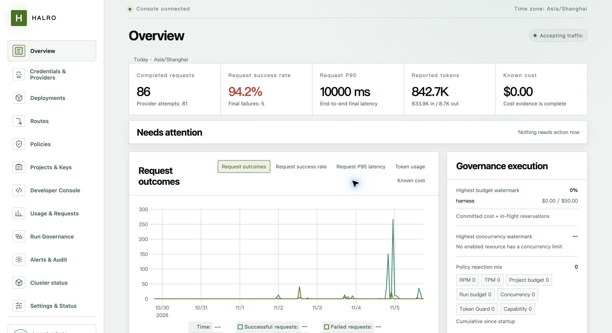

# Halro

[](https://github.com/akz142857/Halro/actions/workflows/ci.yml)
[](go.mod)
[](LICENSE)

Halro is a self-hosted LLM gateway that gives applications one governed API
across model providers. Keep provider credentials private, control access and
spending, and trace each request from routing to settlement.

One Go binary includes the Chinese/English Admin console, encrypted local
storage, and durable accounting. No external database or cache is required.

[Website](https://halro.ai/en/) · [Documentation](docs/README.md) ·
[中文使用指南](docs/guides/user-guide.zh-CN.md) ·
[Release notes](CHANGELOG.md)



## What Halro does

| Area | Capabilities |
| --- | --- |
| Model access | OpenAI-compatible Chat, Embeddings and stateless Responses; Anthropic Messages and token counting; JSON and streaming where supported by the selected profile. |
| Routing | Public model aliases, capability-aware deployment selection, bounded retries, fallbacks, circuit breakers and concurrency limits. |
| Access and policy | Project-scoped Gateway Keys, allowed models, CIDR rules, RPM/TPM limits, Token Guard anomaly protection and redaction policies. |
| Accounting | Budget reservations before provider access, durable per-attempt settlement, immutable price versions, usage/cost evidence and reviewed recovery from clock-related price quarantine. |
| Run governance | Work Units, per-Run budgets and request attribution, versioned business outcome definitions, outcome recording and reporting. Applications supply outcomes; Halro does not execute or evaluate workflows. |
| Admin and integration | Bilingual console, developer workbench, request diagnostics, usage/audit views, project integration instructions and downloadable `SKILL.md`; TOTP MFA and session-expiry recovery. |
| Operations | Encrypted backup/restore, authenticated Prometheus metrics, Alertmanager rules and an independent `halro-deadman` monitor. |

Supported provider families include OpenAI, Anthropic, Azure OpenAI, DeepSeek,
Volcengine ModelArk, MiniMax, Kimi, Gemini Beta, AWS Bedrock Mantle Beta, and
OpenAI-compatible services. Each uses a versioned **Provider Profile** that
fixes its access surface, authentication and supported operations. Capability
coverage varies by profile and model; unknown or unsupported fields fail before
provider access. Model discovery is separate from capability evidence.

See the [provider capability contract](docs/contracts/provider-capabilities.md)
and [per-profile API coverage](docs/compatibility/endpoint-manifests.json).
Bedrock is offered through Mantle alone. The five Bedrock Runtime and Agent
Runtime Profiles are withheld in this build; use the
[AWS access-surface guide](docs/guides/aws-surface-selection.md) when configuring Bedrock.

## Quick start

### Install and start locally

On macOS or Linux with Homebrew:

```bash
brew install halro-ai/tap/halro
mkdir halro-local && cd halro-local
halro start
```

For Debian/Ubuntu APT installation or prebuilt Linux/macOS archives, use the
[installation guide](https://halro.ai/en/install/).
Installation alone does not initialize or start an instance.

On first `start`, Halro creates `config.yaml`, a local Master Key and encrypted
storage, then prints the Admin URL. Defaults listen on loopback only. Open
[http://127.0.0.1:8081/admin/setup](http://127.0.0.1:8081/admin/setup) to create
the first administrator. Configure the following in the console:

```text
Credential → Provider → Deployment → Route → Project → Gateway Key
```

Set the deployment's pricing explicitly, give the Route a public alias such as
`chat`, and allow that alias in the Project. Copy the Gateway Key when it is
shown; applications use this `gw_...` key, never the upstream credential.

### Make a request

Set `HALRO_GATEWAY_KEY` to the key you created, then call your configured alias:

```bash
curl http://127.0.0.1:8080/v1/chat/completions \
  -H "Authorization: Bearer $HALRO_GATEWAY_KEY" \
  -H "Content-Type: application/json" \
  -d '{"model":"chat","messages":[{"role":"user","content":"Hello"}]}'
```

The [User Guide](docs/guides/user-guide.md) covers SDK examples, configuration,
budgets and troubleshooting. The console can also export project-specific
integration instructions without exposing or creating a Gateway Key.

### Run with Docker

Release images support `linux/amd64` and `linux/arm64`:

```bash
docker pull ghcr.io/akz142857/halro:v0.12.2
```

Follow the [container deployment guide](docs/guides/operator-guide.md#optional-container-image)
for the complete configuration, persistent data volume, Master Key mount,
explicit `init`/`serve` steps and listener settings. The image runs as a non-root
user and has no shell. Pin the reviewed release digest for deployment.
Registry images are not themselves signed; signed OCI archives are available
with the release.

## API status

| API | Scope |
| --- | --- |
| Chat Completions and Embeddings | Published compatibility contracts; coverage depends on the Provider Profile. |
| Responses | Stateless create and text SSE. Project-opt-in `background: true` execution with retrieval, cancel and delete is Experimental; see [Deferred Responses](docs/guides/deferred-responses.en.md). |
| Anthropic Messages | JSON/SSE and `count_tokens`, with portable or native profile routing. |
| Models, Moderations, Images, Audio, Files and Batches | Experimental. `/v1/models` lists configured aliases accessible to the key, rather than upstream model discovery or a capability guarantee. |
| Realtime and stateful Responses | Not implemented. `store: true` and stateful conversation fields are rejected. |

The [compatibility manifests](docs/compatibility/README.md) define endpoint and
profile maturity, accepted fields and deviations. An implemented adapter does
not imply that its profile is served by the current build.

## Security and operations

- Provider credentials are encrypted at rest; Gateway Keys are stored as
  one-way hashes. Admin secrets and CSRF state stay out of browser storage.
- Outbound transport enforces HTTPS, host/IP validation, pinned dialing and no
  redirects. It does not inherit environment proxies; configure supported
  outbound access explicitly.
- Admission and accounting fail closed. Ambiguous provider outcomes are settled
  conservatively rather than assumed to be free or safe to retry.
- Prompts and response bodies are excluded from logs, metrics and audit records.
  Opt-in failure capture and deferred-response storage retain encrypted payloads
  with access controls and expiry; review those settings before enabling them.
- Preserve the complete data directory and back up the Master Key separately.
  Standalone storage has one writer. Read the [backup/restore guide](docs/guides/backup-restore.md)
  before upgrades; production exposure requires the [TLS and listener configuration](docs/guides/operator-guide.md#tls-and-inbound-exposure).
- Manually operated Primary/Replica HA is **Experimental and unsupported for
  production**. Implementation and local checks do not establish target-environment
  availability or recovery guarantees; see the [HA guide](docs/guides/ha-usage.en.md).

For hardening and recovery, use the [Operator Guide](docs/guides/operator-guide.md)
and [Threat Model](docs/architecture/threat-model.md). For monitoring, use the
[Prometheus/Alertmanager deployment guide](deploy/observability/README.md).

## Verify release downloads

Use a fresh directory and install GitHub CLI, cosign v2.2+ and a SHA-256 checker.
Set `RELEASE_COMMIT` to the full commit SHA recorded in the chosen release notes.
The current release workflow runs from `main`: its signing identity is the
branch identity below, while the attestation must match the **exact release commit**.

```bash
(
set -eu
# Download all assets so the complete checksum manifest can be checked.
gh release download v0.12.2 --repo akz142857/Halro
: "${RELEASE_COMMIT:?Set RELEASE_COMMIT to the full SHA from the release notes}"
COSIGN_IDENTITY='https://github.com/akz142857/Halro/.github/workflows/release.yml@refs/heads/main'
COSIGN_ISSUER='https://token.actions.githubusercontent.com'

# Authenticate the manifest before trusting its hashes.
cosign verify-blob --certificate-identity "$COSIGN_IDENTITY" \
  --certificate-oidc-issuer "$COSIGN_ISSUER" \
  --bundle checksums.txt.sigstore.json checksums.txt
sha256sum --check checksums.txt  # macOS: shasum -a 256 --check checksums.txt

# Verify every listed artifact, including Debian packages and SBOMs.
while read -r checksum artifact; do
  cosign verify-blob --certificate-identity "$COSIGN_IDENTITY" \
    --certificate-oidc-issuer "$COSIGN_ISSUER" \
    --bundle "$artifact.sigstore.json" "$artifact" || exit 1
  gh attestation verify "$artifact" --repo akz142857/Halro \
    --source-digest "$RELEASE_COMMIT" --source-ref refs/heads/main \
    --cert-identity "$COSIGN_IDENTITY" || exit 1
done < checksums.txt
)
```

Stop if any verification fails. Historical releases may use a different signing
identity; use that release's own verification instructions.

## Documentation and development

| Start here | Reference |
| --- | --- |
| Use and integrate | [User Guide](docs/guides/user-guide.md) · [简体中文](docs/guides/user-guide.zh-CN.md) |
| Deploy and operate | [Operator Guide](docs/guides/operator-guide.md) · [Backup/restore](docs/guides/backup-restore.md) · [Configuration example](configs/config.example.yaml) |
| Govern runs and outcomes | [Data flow and responsibility boundaries](docs/architecture/run-governance-data-flow.zh-CN.md) |
| Understand contracts | [API compatibility](docs/compatibility/README.md) · [Gateway correctness](docs/contracts/gateway-correctness.md) · [Audit integrity](docs/contracts/audit-integrity.md) |
| Explore the project | [Documentation index](docs/README.md) · [Architecture decisions](docs/adr/) · [Implementation evidence](docs/milestones/implementation-status.md) |

Build and start from source with Go 1.26.10+:

```bash
git clone https://github.com/akz142857/Halro.git
cd Halro
make start
```

The committed Admin bundle is embedded in the binary. Node.js 22/npm are needed
only to rebuild it after frontend changes (`make frontend`). Follow
[CONTRIBUTING.md](CONTRIBUTING.md) and [AGENTS.md](AGENTS.md) for scoped checks and
the final quality gate. Real-provider tests are opt-in and may incur charges.
Release procedures are in the [release guide](docs/guides/releasing.md).

## Community and license

Use [GitHub Issues](https://github.com/akz142857/Halro/issues) for bugs and
proposals; report vulnerabilities privately under [SECURITY.md](SECURITY.md).
See [SUPPORT.md](SUPPORT.md) and [CODE_OF_CONDUCT.md](CODE_OF_CONDUCT.md).

Licensed under [Apache 2.0](LICENSE).
Third-party attributions: [NOTICE](NOTICE) · [THIRD_PARTY_NOTICES.md](THIRD_PARTY_NOTICES.md).
