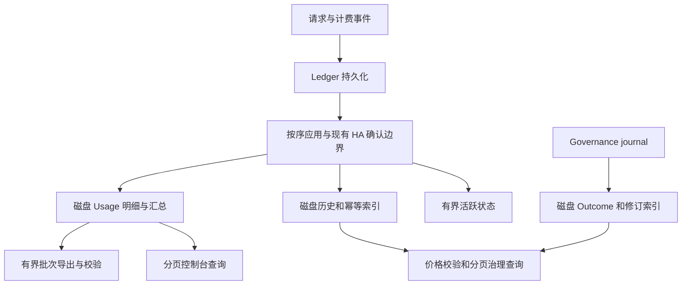

# Halro 内存有界状态与历史持久化改造方案

**续作入口（2026-10-09）：[续作交接](memory-bounded-resume.zh-CN.md)**——当前提交、用户裁定、卡点、待回答问题和下次顺序都在那里。

2026-10-08 路线调整（用户裁定）：D-04 拆为 D-04a 本地容量与 D-04b 生产校准；允许 Ledger 请求池与 Metadata 窗口并入共享执行池，池内保留终结优先槽；十万冷迁移归入 M3。新顺序为 S0 稳住工作树 → S1 预算闭合 → S2 逐项接受 → S3(M3) 冷构建，见[进度看板 §14](memory-bounded-convergence-plan.zh-CN.md#14-2026-10-08-用户裁定与路线调整)。任务总数因拆分变为 25 项（5 完成 / 20 开放，其中 D-04b 随 D-01 暂缓）。

2026-10-08 P1 最新检查点：Directory/Usage/Governance 三个真实后台消费者已接入 foundation 持有的有限共享 RAM 池，嵌套/排队/最终释放及实际双角色 TLS/ext4/race 验证通过。实际节约 **269135872 B（256.667 MiB）**；修正后的必要 normal 为 **789.386 MiB / 54 claims**，原 2 GiB 配置仍缺 **128.386 MiB**，完整阶段峰值和容量接受未通过。Ledger 请求与 Metadata 窗口仍独立保留。原24项仍5完成/19开放，P2尚未进入。详见[预算可行性裁定](memory-bounded-budget-feasibility.zh-CN.md)与[进度看板](memory-bounded-convergence-plan.zh-CN.md)。此前未共享必要下界1046.053 MiB、旧金额与失败结果保留当时范围。

2026-10-08 进度管理调整：后续以[交付计划与进度看板](memory-bounded-convergence-plan.zh-CN.md)追踪，先在 2 小时有效工作上限内完成预算可行性裁定，再进入固定预算运行与冷迁移验证；时间上限用于裁定，不是全部完成承诺。1 GiB 进入可行性比较，原 2 GiB 接受目标尚未变更。原任务仍为 5 完成、19 开放。

2026-10-08 本轮裁定：已导出实际工作池费用并接入配置预检。**原 normal 容量为 661 MiB，仅五个必要工作 owner 加 Pricing 就至少需 979.526 MiB，缺口 318.526 MiB，尚不含其他持久 owner 与完整并发。**已修复启动 peer 重连、取消后的信用退休、采样器退出顺序、Replica bank 重开、Ordering 启动续期及在线 Replica 租约交接。私有逻辑 4 GiB / 实际 2 GiB cgroup 的两轮真实 TLS + HTTP + Close 诊断通过；当前仓库真实 ext4 信用与在线 checkpoint 组件回归通过。**原逻辑 2 GiB 配置、十万冷迁移及完整公共 HA 接受仍未通过，24 项仍为 5 完成、19 开放。**费用表、失败链和证据边界见[本轮裁定](../verification/performance/2026-10-08-ha-resource-vector/README.zh-CN.md)，逐项条件见[最新剩余任务清单](../verification/performance/2026-10-08-ha-resource-vector/remaining-task-register.json)。

2026-10-07 集成复核：已修复启动时 Usage 与历史审计的 native 读取竞争，连续 12 次启动验证及 App 等七个受影响核心包的完整检查通过，物理用例另经实际 ext4 验证。**固定 2 GiB HA 配置仍在空库启动的 Governance 原始 completion-pool 申请被拒绝：normal 剩余 46.824 MiB，本笔需要 128.346 MiB，最低缺口 81.521 MiB，尚不含后续组件。**十万冷迁移失败保持；完整 `go test ./...` 的原失败记录也保留，包级复核不冒充全仓库绿色或目标接受。公共 HA 全物理 guard 未打开，原 19 项条件未关闭。具体修复、逐包结果、冻结输入和实际资源退休见[集成裁定](../verification/performance/2026-10-07-memory-state-authentication-reuse/integration-decision.zh-CN.md)。

2026-10-07 当前裁定：保留原生事实、精确账务、七根共同发布和可信增量恢复。已迁移的 Standalone 与已激活的 HA 业务路径已有本地接线证据；**冷迁移成本、完整 HA 物理模式和生产接受尚未通过，不能宣布整个方案完成。**

当前成本证据：v8 的一万请求迁移单次 295.347 秒通过原 300 秒门槛，但十万请求在原 1800 秒期限失败。分页布局、共享原值/紧凑 blob 和分页认证复用均未通过预定筛选。最新九次对照中 v8 / 分页组合 / 分页认证复用中位数为 **12.372 / 18.649 / 16.811 秒**；认证复用仍比 v8 慢 **35.88%**，拒绝接入。现有 512 字节基线的单项认证复用也已筛选结束：中位数 11.539 → 9.930 秒，改善 13.95%，未达 30% 门槛，拒绝启用。详见[成本裁定](memory-state-cost-decision.zh-CN.md)及[本轮证据](../verification/performance/2026-10-07-memory-state-authentication-reuse/README.zh-CN.md)。

原中断 Roll 故障已复核为夹具错误：先发布包含已完成 Roll 的共同快照，再将目录退回未完成状态，本应拒绝。合法中断夹具已修正，intent / renamed / successor 三布局重开通过，三个已提交目录回退拒绝通过，定向 App race 通过。未放宽 Ledger 源验证；原失败保留，完整 Roll / Compact 崩溃矩阵仍开放。

| 交付 | 当前状态 | 接受条件 |
| --- | --- | --- |
| C-1 冷构建成本 | 当前 v8 十万失败，分页候选全部拒绝；v8 单项认证候选也已筛选拒绝 | 同职责下相对同期 v8 改善至少 30%，随后通过原始容量门槛 |
| C-2 目标完整生命周期 | 小规模生命周期和低驻留已证明，目标容量与吞吐未接受 | 原 10k / 100k 期限、实际 RAM/空间、精确业务与退出义务全部通过 |
| C-3 HA 与完整物理模式 | 业务七根/TLS 已接；公共 HA physical opening 仍拒绝 | 全角色原目标预备、确认、在线维护、切换及压力/故障接受 |
| D-01 / R-01 | 按先前用户指示暂缓生产取证和发布观察 | 提供现场入口、窗口与实际发布镜像后另行取证 |

§8.2 的原始完成条件保持，24 项中 5 项完成、19 项开放，不换算工作量百分比。逐项本轮状态见[剩余任务清单](../verification/performance/2026-10-07-memory-state-authentication-reuse/remaining-task-register.json)。当前运行边界见[维护契约](../contracts/memory-bounded-maintenance.zh-CN.md)，原逐轮日志保存在[历史附件](memory-bounded-state-progress-history.zh-CN.md)，其中当时的“未接入”“正在运行”不代表当前状态。


- 日期：2026-10-02
- 当前执行范围：2026-10-06 用户明确要求先完成功能，暂不执行 D-01/R-01 生产环境取证；本地功能、迁移和故障验证继续执行。
- 状态：修订稿三角色定向复核完成（§11.3），实施进行中；[本地存储实施选择](memory-state-storage-decision.zh-CN.md)已固定，完整角色协议、资源参数接受与生产验收尚未完成。当前源码及剩余条件见本文开头和 Runtime 维护契约；§8 历史实验保留当时边界。
- 分析基线：`2425ae8ebb957cecfd79508f8fa9b227701c4349`，另有本地未提交诊断改动。
- 目标：消除累计历史量驱动的常驻内存增长，使启动、运行、归档、校验和恢复的内存都受预算约束。
- 初始容量目标：在明确的实体规模、并发、请求大小和吞吐量下，通过 2 GiB cgroup 限制的 Linux 容量验收。1 GiB 是否可用另行验证，不作承诺。
- 取证操作：[Halro 启动内存与 cgroup OOM 取证](../memory-oom-runbook.zh-CN.md)。

## 1. 结论与证据边界

原分析基线将历史事实、幂等索引和运行时状态一起保存在内存中。Ledger 的历史预留、结算和事件摘要没有淘汰路径；Usage 的时间窗口仍使常驻成本与吞吐量乘窗口长度成正比。全量快照、导出中间数组和恢复解码又放大峰值。

因此，将限制从 1 GiB 提高到 2 GiB 只能容纳当前工作集，不能改变增长模型。解决方案必须同时包含历史持久化、活跃状态边界、字节预算、入口准入和有界后台处理。

### 1.1 生产证据

用户提供的现场输出显示：

- 原 Swarm MemoryBytes 为 `1073741824`，即 1 GiB。
- 同一镜像的多个任务以 137 退出。
- 将限制调整为 2G 后，新任务收敛为 Running。
- 当前容器读数为 `1.188 GiB / 2 GiB`、59.41%，CPU 为 0.05%，PIDS 为 10。
- 镜像 digest：`sha256:14760989878dbf4523ac4a013a6156e9773b8c6aae137c664f571dc37426bded`。

137 说明进程被 SIGKILL；严格确认 cgroup OOM 仍应关联同一任务的内核日志或 OOMKilled 字段。用户此前报告了 cgroup OOM，但本轮未拿到对应原始内核日志。docker stats 不是单独的 Go heap 或进程 RSS；PIDS 也不是 goroutine 数量。

尚未取得生产 heap profile、smaps_rollup 和连续内存曲线，也未验证该镜像与分析源码完全一致。 [只读采集器](../verification/performance/2026-10-04-live-memory-collector/README.md)已准备并通过本地测试，能绑定唯一任务/PID/可执行文件、解析cgroup v1/v2并记录连续曲线；当前没有生产访问入口，未执行现场采集，不以工具完成代替D-01证据。因此，本方案确认的是当前源码的增长路径，不将本地实验数值当成生产 1.188 GiB 的归因比例。

### 1.2 本地合成实验

使用本地 Go runtime，构造接受、预留、开始、结算、完成五个事件，按序调用 Ledger State.Apply；第二组同时调用 Usage Aggregate.Apply。测量点主动 GC，并保持状态对象存活。没有调用真实模型，也没有访问生产数据。

| 请求数 | 仅 Ledger 存活 heap 增量 | Ledger + Usage 存活 heap 增量 |
| --- | ---: | ---: |
| 10,000 | 25.77 MiB | 约 36.4 MiB |
| 100,000 | 276.24 MiB | 约 379 MiB |

10 万条 Usage 明细再调用一次 Snapshot，额外存活 heap 约 84.69 MiB。本地结构体大小为 Event 792 B、Record 856 B、SettledAttempt 824 B、AttemptEvent 648 B、RequestSummary 240 B。

这些数据证明历史状态和数组复制的成本，不能作为生产容量承诺。fixture 使用简化字段，不含价格快照和完整生产元数据；未测数据库映射、网络并发、编码峰值或 cgroup 总内存。临时实验程序已删除；实施时应把相同生命周期转为可重复运行的容量基准，保留 Go 版本、架构、fixture、profile 和结果。

## 2. 当前内存消费者与调用依赖

下表保留原分析基线的消费者与依赖。当前默认 Standalone 已将 Ledger 历史域状态迁入每次完整认证重建的磁盘投影，恢复也改为两级分页；默认 Standalone Governance/Usage 已选 fresh 磁盘 owner。默认 Primary 业务 Ledger 已选 fresh 磁盘投影，Usage 共用该账务证据，真实确认及分页恢复完成后才发布 ready；Primary Governance 也已选 fresh 磁盘 Manager，保留外部锚认证及真实排序确认。默认 Replica 已选 applied-cut Ledger/Usage 双磁盘 generation。可信恢复、共享物理费用和其他未闭合边界以 §8 的最新证据记录为准。

| 消费者 | 保留内容与增长特征 | 当前读取依赖 | 处理方向 |
| --- | --- | --- | --- |
| Ledger eventDigests | 每个历史事件的 ID 和摘要；随事件数增长 | 重复事件和冲突事件校验 | 磁盘精确索引，有限缓存 |
| Ledger leaseRecords | 每个 attempt 的原始预留 Record；结算后仍保留 | price pin 恢复、备份价格校验 | 历史磁盘索引；活跃 lease 有界 |
| Ledger settled | 完整结算事件及摘要；随 attempt 数增长 | 备份校验、治理 cohort 查询 | 磁盘明细与查询索引 |
| Ledger balances | 项目、期间、时区版本对应的余额 | 预算准入、跨日未完成结算 | 磁盘为完整视图，活跃期间有限驻留 |
| Ledger 治理 map | WorkUnit、Run、已结算索引、治理幂等记录 | 创建/关闭、预算、结果查询 | 活跃状态与历史分离 |
| Ledger segment 目录 | segments.json、Log.segments 保存全部历史 generation；加载和维护复制全列表 | Open、Replay、Roll、Compact、verify、备份与指标 | 持久化有序索引、有界 cursor、固定大小汇总接口 |
| Usage attempts / summaries | 明细、请求摘要、价格快照；按窗口保留 | 控制台分页、导出、checkpoint | 明细磁盘分页，内存只留有限缓冲 |
| Usage hourly / rollup delta | 小时及维度汇总；维度和积压仍影响大小 | Dashboard、汇总与 checkpoint | 有界汇总缓存、分批落盘 |
| Governance State | Outcome、修订、幂等和多重历史索引 | 结果上报、查询、checkpoint | 磁盘索引、有限热点缓存 |
| 队列及在途请求 | Record、请求体、响应、流式等待数据 | 写入、调用、确认、后台处理 | 数量与字节双重限制 |
| HA 未确认后缀 | LocalCommit payload、pending 与复制数组；确认停滞时保留 | Primary 启动恢复、发送重试 | 磁盘范围、有界帧窗口和未确认写入准入 |
| 部署价格 timeline | 单部署所有历史价格版本，首次加载后完整缓存 | 价格选择、历史完整性审计 | 磁盘时间点查询、流式审计、有限版本缓存 |
| 遗留 request / attempt 恢复 | 全量 PendingLeases slice；未 finalized request 可能没有 pending lease | 冷启动保守结算、request 终结及活跃额度释放 | 两级磁盘 cursor、确定性幂等终结、恢复专用预算与批次 |

相关源码：

- `internal/ledger/event.go`：State、Apply、AccountingLease、SettledAttempts、GovernanceSnapshot。
- `internal/ledger/log.go`、`segment.go`、`seal.go`：全量 segment manifest 加载、常驻列表、Roll/Compact 发布及校验。
- `internal/app/metrics.go`、`ledger_seal.go`：Segments 全量复制用于指标与后台压缩。
- `internal/app/runtime.go`：Ledger 全量回放、Usage checkpoint 恢复、定时维护和导出。
- `internal/app/replication_runtime.go`：Replica 的 Ledger/Usage 恢复和 NativeProjection。
- `internal/budget/manager.go`：appendApplyRecord 的持久化、顺序 Apply、失败封闭和确认。
- `internal/store/bolt/store_pricing.go`：RecoverDeploymentPricePins。
- `internal/store/bolt/pricing_backup.go`：ValidateDeploymentPriceReferences。
- `internal/usage/aggregate.go`、`checkpoint.go`、`parquet.go`：常驻明细、恢复、复制、导出与校验。
- `internal/governance/manager.go`、`internal/store/bolt/store_outcomes.go`：Outcome 内存索引、完整 checkpoint 重组。
- `internal/store/bolt/journal_class.go`：权威数据与本节点派生数据的复制分类。
- `internal/replication/recovery.go`、`primary.go`：ReconstructRange、pending、PendingFrom 的未确认后缀驻留和复制。
- `internal/store/bolt/store_pricing.go`：auditedDeploymentTimeline 全历史加载、审计和缓存。
- `Dockerfile`：readiness 健康检查的 10 秒 start-period、30 秒 interval 和 3 次失败。

### 2.1 确认的放大路径

1. 启动从头回放 Ledger 到 State，历史重新变成常驻对象；重启不能缩小最终工作集。
2. Usage 恢复逐段解码，但最终把所有保留明细 append 到内存；磁盘分段没有限制最终工作集。
3. loadUsageCheckpoint 只为比较 watermark 调用 Snapshot，额外复制全部明细。
4. admin_usage_summary 同样只为读取 watermark 调用 Snapshot。
5. Usage 导出经历 Snapshot、pending、按日期分组、Parquet 行及编码缓冲，多份数组可能同时存活。
6. Usage 窗口裁剪在定时导出之后执行；默认导出周期为一小时。归档失败时不裁剪未归档历史，这保住数据但没有限制 RAM。
7. Exporter.Verify 建立覆盖归档记录的 map；离线维护也需要有界设计。
8. Governance checkpoint 在磁盘分段，但读取时拼接完整 payload，再解码完整状态。
9. Ledger Compact 压缩磁盘 segment，不会淘汰 State 的历史 map。
10. 原始路径中 RecoverLocalCommits 通过 ReconstructRange 收集整个未确认后缀，coordinator 再持有 pending；PendingFrom 还会复制后缀。当前生产 Primary 启动使用 Source 逐条完整验证，coordinator 不保留 payload map，两个 peer 各有有限发送窗口；PendingFrom 只返回有限页并显式报告读取错误。旧 slice/stream 构造接口仍保留 payload cache；共享费用、未确认 append 前准入、Source IO 和角色 generation 未完成，不能据局部窗口宣布 HA 整体有界。
11. auditedDeploymentTimeline 先 ListDeploymentPriceVersions，再审计并缓存全历史；单部署对象本身即可超过缓存预算，加载后再做缓存准入已经太晚。
12. RecoverPendingLeases 调用 PendingLeases 生成完整 slice。遗留未完成状态超过新限制时，迁移后的恢复仍可能 OOM。
13. Ledger 的 segments.json 通过 ReadFile 与 Unmarshal 完整加载，Log.segments 常驻全部历史目录；Roll、Compact、Segments 和 VerifySegments 复制或生成全量列表。压缩历史文件不缩小目录，指标抓取和后台维护也会放大峰值。
14. 带 Run 的 RequestAccepted 写入 requestRuns/activeByWorkUnit，只有 RequestFinalized 才清除。现有恢复只结算 PendingLeases；accepted 后尚无 lease、或 attempts 已全部 settled 但尚未 finalized 的请求会残留，持续占用活跃状态并使 WorkUnit 保持 in-flight。

默认 Usage 窗口为 30 天。即使只有 1 请求/秒、每请求一次 attempt，也有 259.2 万条 attempt 和 summary；按本地结构体合计 888 B 计算，仅元素空间约 2.14 GiB，未计字符串、价格快照和容量余量。按天限制历史不能保证固定内存。

## 3. 必须保持的正确性契约

- Ledger 继续是计费事实来源，Governance journal 继续是 Outcome 事实来源；投影可以重建。
- 幂等和冲突识别保持原语义。缓存未命中必须查持久化索引，不能解释为事件或结算不存在。
- 不给历史去重/结算 map 直接添加 LRU；任何未来的幂等保留期限变化都必须作为独立产品与协议变更。
- 已预留但未完成的调用不能被 TTL 静默删除；超时需要持久化、可恢复的终结流程。
- request 与 attempt 分别恢复和终结；没有 pending lease 不能证明 request 已完成。活跃额度释放必须对应持久化终结事实，并满足适用的 HA 确认门禁。
- 跨日调用在原接受期间结算；历史余额不活跃不代表可以丢弃。
- price pin 恢复和备份必须继续验证原始 lease、价格快照摘要及 ledger sequence。
- 账本持久化、状态按序应用和 HA 确认的现有边界不能因改造被放宽。
- 计费投影应用失败时停止新计费调用，不能让预算准入读取过期余额后继续调用上游。
- 归档发布成功前不得推进导出水位，不得删除唯一的未归档派生明细。
- 统计明细、汇总及其 applied watermark 必须对应一致的日志前缀，避免崩溃后重复累加。
- 日志 anchor 只能证明日志位置，不能单独认证余额、结算或幂等索引内容；恢复前必须验证投影内容或从认证日志重新生成。
- 持久化的本地已应用位置可能合法领先确认位置。角色变化时重建正确前缀，不能只调回 watermark。
- 新准入上限不能阻止遗留 pending 的恢复和在途请求的终结；恢复额度同时覆盖 RAM、未确认写入与磁盘。
- Ledger segment 目录有界改造须保持 generation 连续性、历史缺失检测、链连接及 Roll 崩溃修复；不能通过删除历史目录条目满足内存目标。

## 4. 目标结构

### 4.0 最终目标、过渡路径和决策门禁

最终目标是认证状态快照加增量日志恢复、磁盘历史索引、有界活跃状态、分页 Usage 和共享资源准入。不能把每次全量重建作为最终正常启动方案：它解决常驻内存，却使启动读取、重建写放大和暂存空间随历史增长。

| 场景 | 最终目标行为 | 快照协议尚未通过时的过渡行为 |
| --- | --- | --- |
| 普通冷启动 | 验证快照内容、完整性及日志/角色位置，恢复快照后的增量 | 从认证日志完整、有界重建；需单独验证可接受的停机、写入和空间成本 |
| 首次迁移或投影损坏 | 完整、有界重建，并生成可验证快照 | 同一完整重建路径 |
| 允许的 HA 前缀缩小 | 选择不领先于允许前缀的可信快照，增量重建新 generation | 从允许前缀完整、有界重建 |
| 备份恢复 | 快照验证通过才作为起点，否则完整重建 | 不信任旧投影作为起点 |

过渡版本可按独立阶段交付，但必须标注“内存增长阶段性修复”，不能宣称最终启动架构完成。若现有生产历史使全量重建超出可接受维护窗口，过渡路径不得发布为正常启动默认方案，认证快照成为该版本的前置交付。

以下技术选择目前待证据收敛，不以“最佳方案”名义提前固定：

1. 同 metadata DB 派生 buckets 与独立派生 DB 的对比：计费和配置写延迟、写放大、mmap/freelist 工作集、备份、HA schema 准备及恢复复杂度。独立 DB 会失去部分跨库原子性，必须补位置与恢复协议；同库也必须证明写竞争可接受。
2. 认证快照的内容/键集合认证机制、生成发布与读取验证方式，必须先评审后实现。无需自行发明密码算法；普通 checksum 或已签 watermark 不能替代内容认证。
3. 2 GiB 预算、缓存大小、批次和并发限制经目标 Linux 基准确定；当前表格只用于试验。
4. 根据生产 profile 排序收益。每个阶段独立证明账务正确性和内存改善，不一次性改完所有模块后才验证。

下图为最终目标的数据流；过渡模式改变恢复路径，不改变事实来源和准入契约。



### 4.1 Ledger 持久化投影

优先复用现有 bbolt 能力，不引入外部服务。存储布局须通过 §4.0 和任务 D-02 的对比实验后确定；同 metadata DB 派生 buckets 是候选方案，不是已作出的最终决策。选择同库时新增 buckets 显式分类为本节点派生数据；选择独立派生库时补齐跨库恢复、水位与备份一致性协议。

需要持久化的逻辑索引至少包括：

- event ID → digest。
- attempt ID → lease 证据与 settlement。
- 项目/期间/时区版本 → balance。
- request/attempt → 活跃索引、终结状态与恢复资料；request 保存接受事件位置、项目、原期间/时区版本、WorkUnit/Run 归属及 attempt 关联，能够独立枚举尚未 finalized 的请求，并在 finalized 后验证其遗留 pending attempt 的迟后 settlement。
- WorkUnit、Run、治理幂等记录及按项目/状态/归属的查询索引。
- 完整处理位置：generation、sequence、offset、对应 chain anchor 和投影版本。

每批在一个 bbolt 事务中原子提交索引、余额、未完成状态变化与处理位置。该批失败不得推进位置；已提交批不能重复累加余额。持久化投影不得先于对应 Ledger 事实。

内存只驻留当前预算准入、未完成调用和热点读取所需的对象。磁盘投影保存完整状态；缓存必须有字节上限，冷状态通过磁盘读取。项目级锁和缓存项也需要生命周期管理，避免已删除或冷项目继续累积。

第一版保持计费状态应用屏障：在前序状态可见之前，不做依赖它的预算准入。沿用持久化 → 按序 Apply → 确认的行为。不得为了吞吐先引入无界异步投影。分批提交和 group commit 的延迟/吞吐收益应单独验证。

#### 4.1.1 投影内容信任协议

最终正常启动使用认证状态快照加增量日志恢复。内容认证协议在 D-03 完成评审前不得以持久化投影作为跨重启的可信起点。

目标协议必须同时满足：

- 认证覆盖所有安全关键值和键集合，包括余额、未完成状态、lease、settlement、事件摘要、治理幂等及相关索引；能识别关键记录删除/不存在，不只认证 head。
- 绑定 schema、投影算法版本、instance/cluster/incarnation、角色/term 与完整日志位置/链 anchor，并检查快照不领先于当前角色允许前缀；旧快照能否用作起点须按权威日志位置裁定，不能回放后丢掉新事实。
- 生成时冻结一致的日志前缀，分批输出，不构造完整内存快照；完成全部数据写入、同步和认证发布后才激活。认证信息不能与部分内容分别提交而暴露半成品。
- 验证覆盖快照内容和索引一致性；增量每批原子推进。失败、缺失或无可用历史时不开放服务，按明确的有界重建/恢复路径处理。
- 不能只验证签名后的旧快照，再从未经认证且已变化的普通投影 DB 跳过日志读取。快照材料、运行投影及后续增量的信任链须在协议中闭合。
- checkpoint 生成、备份恢复、角色切换和日志保留必须共同定义；快照不能成为未经评审删除原账本历史的理由。真实性不等于业务计算正确，还需新旧视图和故障测试。

D-03 的展开协议见 [认证根候选草案](memory-state-authenticated-root-protocol.zh-CN.md)。启动保留全部权威历史文件存在/长度的有界目录检查；实际使用页逐路径认证，未访问历史字节另作有期限/进展门禁的完整审计。任一安全关键缺失/损坏使全局业务 readiness=false，不返回假空。目录元数据检查的 O(segment 数) 成本与事实 decode/replay 增量分别验收；未消除该成本前不能宣称整个启动与历史目录规模无关。Metadata 必须具备完整认证 epoch 基线与匹配后缀；现有 journal 不能独立重建 epoch 初始整库。首次基线接受、整文件发布/密钥轮换及 trim 位置协议尚未闭合，禁止自动信任当前 live DB。

正常启动的增量目标须覆盖原生日志 Open、认证及 State 恢复的整个路径。仅替换 State 的回放起点，而 Governance/Audit/HA Ordering 等 Open 或 cursor 恢复仍从头扫描日志，不能证明启动读取已改为增量；D-03/I-11 需明确安全的日志初始化起点与验证协议，不得直接跳过原有认证检查。

快照尚未实现或不可信时采用保守过渡：每次冷启动在新 generation 中从角色允许的认证日志前缀完整、有界构建；重建期间不使用旧余额/幂等参与决策；通过链、序列及终端 anchor 检查后才切换。该路径具有 O(历史量) 的读取/重建成本，需 §7 的空间和启动门禁，不能据此宣布最终正常启动完成。

运行中的磁盘查询遇到 I/O、解码或关键索引错误仍失败封闭。所有模式都禁止只调 watermark 或把裸 DB 校验和当成投影内容认证。

#### 4.1.2 事务和锁边界

投影事务为本节点派生写入，不混入会等待复制确认的权威 metadata 写入。明确并验证 DB 写事务、账务 apply 屏障与项目准入锁的锁序：项目准入锁不跨持久化等待，DB 事务内不等待 peer 确认、不重新调用同一 DB 的写事务。价格校验等读取不得通过嵌套事务形成回环。数据提交后更新有限缓存的可见版本，失败时不得留下领先于磁盘的余额缓存。批处理 callbacks 若重试，必须保持现有幂等及重入契约。

磁盘 reader 同样纳入预算：普通查询的读事务只覆盖一页受行数/字节/解码上限约束的数据，在事务外编码、HTTP 输出或等待；cursor 续读绑定 generation/固定高水位，不把事务跨页或跨网络持有。读者数量与最大持有时长经 D-04 确定，迭代主动检查 deadline 并由拥有该事务的线程退出，不并发强制 Rollback 正在访问的事务。bbolt 长 reader 会保留旧页并可能阻塞 mmap 扩容；独立库也不消除此库自身的 reader 风险。备份等必须保留一致长视图的操作，采用经 O-02 验证的资源/时限门禁、失败清理或维护窗口，不能用不一致分页替代一致备份。记录 read-transaction age、pending/free pages、等待及最大写延迟；不能只看 p99 和 Go heap。

### 4.2 Usage 磁盘分页与增量汇总

- attempts、summaries 逐条或分批持久化，建立序列和所需过滤维度索引。
- 使用现有 daily rollup 能力；明细与汇总的处理位置保持一致。
- 控制台按 cursor 分页，页面响应有行数与字节上限；不先扫描/复制全部记录再分页。
- console_window_days 保留查询语义，改为磁盘查询范围，不能靠偷偷缩短窗口满足内存目标。
- Dashboard、分位数与异常查询也要有界；需要精确统计时用分页扫描或合适的持久化聚合，不能无说明地换成近似值。
- Collector 只保留有限通知队列；溢出后从 Ledger 补回放，队列同时受条数和字节约束。
- 导出积压存在磁盘，不能退回全部保存在 RAM。

### 4.3 有界归档、校验和查询

每个批次同时限制行数、输入字节、输出缓冲和编码器工作集。初始可用 1,000 行及 8 MiB 输入作为试验起点，最终以测量为准；行数或输入字节不能替代对 Parquet 编码内存的约束。

导出冻结完整的序列前缀 `[L, H]`，只在该前缀内所有应导出记录都完成原子发布后推进到 H。不能因为先发布某个日期分组的高序列文件，就跳过其他日期中更低的序列。孤儿文件重试必须验证内容一致，保持可重复执行。

Usage 归档 manifest 和 Ledger 原生 segment 目录均不得成为无限内存列表。随着分片数增加，应采用分页索引或分层 manifest，并版本化迁移，保证发布和保留策略可校验。校验使用流式遍历、外部排序或磁盘精确索引，禁止全历史去重 map。Ledger 的额外契约见 §4.3.1。

治理 cohort 查询除了限制 WorkUnit 数，还要限制扫描行数、输出字节和工作内存。超限返回明确错误或分页结果，不能静默截断账务/治理结果。价格备份校验从磁盘 cursor 流式读取，不能调用全量 SettledAttempts 构造 slice。

#### 4.3.1 Ledger segment 目录与维护接口

segments.json 的加载和 Log.segments 的常驻列表都属于改造范围。按 generation/sequence 建立持久化有序索引，Open、Replay、Roll、Compact、verify、备份与 HA 范围读取使用有界 cursor；目录迁移也必须流式读取旧格式，不能先全量 Unmarshal 后才写入新索引。内存只保留当前 generation、有限目录缓存和固定大小统计。

目录记录日志的组成与恢复证据，必须区分权威发布记录和可重建查询索引，不能把唯一目录按普通本地派生投影任意清理。新格式保持从首个 generation 起无间断、sequence/chain 连续、文件存在及内容校验；目录项删除或替换不能令校验悄悄缩小历史范围。Roll intent、文件同步/rename、后继 generation 和目录提交须有原子发布与中断恢复协议；Compact 的目录切换仍是提交点。旧格式兼容、备份和 HA Ledger Roll 处理纳入 reader/schema 兼容矩阵。

替换返回完整 slice 的 Segments/VerifySegments 接口：维护任务分页定位候选，校验逐项输出；指标使用随目录提交一致更新的 count/bytes 汇总，不为抓取统计加载或复制全部条目。验收除增加事件数外，还要固定事件量、增加小 segment 数量，分别测加载、Roll、Compact、verify、备份和指标峰值。不得以合并或删除权威历史掩盖未改造的接口。

### 4.4 Governance 历史持久化

Outcome、修订、幂等和归属索引持久化，内存只留有限热点。单条最多修订次数、每个 WorkUnit 最多 Run 数不能替代全局历史容量管理。

恢复不再拼接完整 checkpoint payload。目标冷启动使用 §4.1.1 的可信快照和认证 journal 增量；协议未通过时采用完整有界重建的过渡模式。不能只校验旧投影位置就跳过内容验证。历史查询分页，不要求完整历史先驻留 RAM。

### 4.5 HA 未确认后缀与帧缓存

ConfirmationTracker 只跟踪当前 tenure 连续注册的 lastRegistered、单一 leadership anchor 与已确认水位；现有 ACK 表示配置 peer 的累计 durable 前缀，两/三节点协议只需一个 peer 即达 quorum，无须按 index 保存 ACK map。保留身份/term/成员、连续注册、单 anchor、未来 ACK 和重复/倒序 ACK 校验；公开 confirmed 与 commit notice 仍经过原有持久化屏障，不能用仅内部 tracker 已推进代替可靠确认。此处不替代未确认 bytes 准入或帧持久化范围。

未确认数据以 ordering journal 和各源 store 的持久化范围为事实，内存只保留游标和按字节/条数限制的发送窗口。Primary 恢复使用 ReconstructRangeEach 等逐条接口，不能先生成完整 LocalCommit slice；coordinator.pending 和 PendingFrom 改为磁盘范围读取及有限窗口，不能把历史 payload 全量复制进 RAM。

当前生产 Primary 启动先 ReconcileLocalStores 认证基线、修复未排序尾部并完成允许的中断 Ledger Roll，再冻结 ordering head，通过 NewPrimaryCoordinatorFromSource/ReconstructRangeEach 逐帧验证。完整后缀成功、consumer 无错误且 head 未变后才持久化成员状态；构造期间不保留完整输入或 pending payload map，也不 enqueue。旧 slice/stream 构造接口保留 cache 兼容路径，仍需退役。OrderingJournal 按固定长度记录定位，无历史 offsets map；四类 NativeSource 范围读取已采用固定大小认证游标。

每个配置 peer 独立记录 durable/queued/notice 水位和固定长度字节槽。当前默认窗口为 16 帧/32 MiB，属于本地防护值，未经过 D-04 生产校准。PreparePeer 仅在已认证的新会话 generation 租约内准备有限初始批次，sender 绑定该具体会话；累计 durable ACK 不得超过该 peer 已 enqueue 前缀，释放槽后从 Source 续读。一个 Replica 确认后，较慢 Replica 仍独立补齐已确认历史；notice 不超过该 peer 已排入 FIFO 的前缀，不重发已应用通知。RetryPending 只填空余窗口，PendingFrom 返回一个条数/字节受限的页，不能把源失败伪装为空历史。窗口与实际会话队列配置联合校验，初始批次留出一条最坏大小 commit notice 的空间。会话替换等待旧 Ready/ACK 租约退出，旧 Closed 回调不撤销新窗口；Stop 清除引用并永久关闭后续写入/读取。

读取或 ordering digest 失败使全局 Primary poison；单 peer 队列失败只撤销该窗口，健康 peer 仍可组成原有 quorum。Hello 只设定发送起点，不提供确认凭据；缺少 prior-term 前缀的 peer 明确要求 reseed，不改写历史 term。启动保留原有 peer adjudication 条件，再冻结完整已接受前缀并等待其确认后才业务就绪，不能只等 leadership anchor 就开放流量。复制先启动、WaitConfirmed 不依赖业务 ready 的维护接口仍保留。

NativeSource 当前额外提供最多两个独立只读 lease，每个 peer 一个；默认构造/恢复/分页游标另用一组，不随重连、请求或历史增长。Prepare 先释放旧 lease 再取得冷游标，Forget、queue/source 失败及 Stop 释放；旧 release 不影响复用后的槽。父级 lifetime 锁使成功/失败 Truncate/Repair 以及 Close 等待已准入读取退出，再重置对应 store 全部游标或关闭 owned streams/清密钥。FrameSource 不具备修复权限，lease 不替代身份/term/generation 规则。真实 Audit 两 peer 交替 ACK 与慢 peer 对照已有本地证据，未完成三节点全部源/网络/状态 fsync 的性能接受。

大帧超过剩余窗口 bytes 时，每 peer 最多保留一个已经通过原生校验与 ordering digest 的候选，独立于已排队的帧/字节窗口；重复 ACK 和 Retry 不再重读同一候选。候选在 Prepare 替换、Forget、单 peer 队列失败或 Stop 后清除；全局 source/成员状态不确定故障立即清除所有候选和 lease。NativeSource 的显式 Truncate/Repair（包括失败）、Close 或 lease 替换撤销 revision token；即使候选仍被 bytes 阻塞也须检查，发送同步复制期间父级读锁排除 mutation/Close。token 只保存固定数量的当前/候选身份，不积累历史。这仍沿用进程内已认证追加前缀信任，不能声称实时检测同 inode 任意旧内容篡改。

可选共享预算启用时，Source coordinator 的构造逐帧验证及每次窗口重建在读源之前取得 Recovery RAM envelope；被阻塞候选继续持有，队列完成独立同步复制后先清除引用再退还费用。HA 配置须显式提供 replication_candidate_ram_bytes，Recovery 类、储备与专用 claim 须同时容纳两个候选、另一次重建三个 session 队列/入站 envelope 和一份 NativeSource 固定读者和一份 Governance 原生缓存预留（共八个 claim）；下限为最大 wire 帧的六倍，只拒绝明显不足，原生 JSON/codec 峰值仍须部署校准。预算拒绝使单会话重连而不 poison 持久化事实；物理 Unknown/Pressured 继续允许专用 Recovery 准入。大帧读取次数、双候选费用、源撤销/关闭与同步复制 join、配置边界及真实 mTLS Runtime 接线的本地证据见 [候选缓存与预算验证](../verification/performance/2026-10-02-primary-candidate-budget/README.md)。

复制 Runtime 的 socket queue 独立副本使用 replication_queue_ram_bytes，在构造 channel 及入队复制前预留整队列字节容量与 queue/writer 元数据的 Recovery envelope；队列已写出不提前退还整个容量预留。每个预算池最多三个 live/retiring session，容纳两个 peer 和一个替换/控制连接；没有共享预算的 ConnectionManager 也按 configured peers+1 限制所有 authenticated session，control-only 不绕过。Send 与 Close 的同一生命周期锁避免关闭后入队；Close 清除未发送尾部、释放 SendSync 等待者，实际 writer 未退出时继续持有费用和槽，不等待可能持 generation lease 的 handler。writer 清除 record 引用后才退队列 bytes，socket Close 完成且 reader/handler、writer 全部退出后再退费用/槽。Primary 和 Replica 使用各自 Runtime 同一 Manager；配置下限拒绝明显不足，TLS/allocator 峰值仍须校准。验证见 [复制队列预算](../verification/performance/2026-10-02-peer-queue-budget/README.md)。

运行时复制入站另配置 replication_read_ram_bytes，与 replication_queue_ram_bytes 在握手完成后、构造会话缓冲及读取首个 stream prefix 前原子取得同一个 Recovery claim。每个会话预留一个最大 wire 帧及同步 Receive、ApplyConfirmed、ACK/control 回调的临时工作集，空闲读取仍持续占用；下限为最大 wire 帧六倍，不能替代部署 codec/allocator 校准。借用 record.Encoded 只在 handler 返回前有效；回调须为长期保留的数据另取 owner。readLoop 每帧处理结束或错误返回先清借用引用；Close 不等待 handler，但 reader/handler 未退出时费用和替换槽不能归还，实际 Read 忽略取消时同样持续持有。两个 peer 加一个 retiring/control 会话上限不变，Recovery RAM 至少覆盖 3×(candidate+queue+read)+reader+governance_log，八个 claim 另计控制费用；溢出先拒绝，Primary/Replica 使用相同接线。旧离线 ExchangeControl 返回 wire 数据的 API 在入站预算启用时拒绝调用，Runtime 使用 Run 的借用回调，离线 CLI 的无预算路径仍待迁移。验证见 [复制入站预算](../verification/performance/2026-10-02-peer-read-budget/README.md)。

NativeSource 长期读者 RAM 另配置 replication_reader_ram_bytes，在复制 owned keys/构造默认读者组前取得一份 Recovery lifetime claim，预留默认与两个 peer 共三组固定游标、密钥副本和可跨请求持有的 Ledger 解压流/descriptor 元数据。每 Source 聚合为一个 claim，不随请求、重连或 generation 数增长，空闲槽仍预留；临时 range 输出/decoder 工作集仍使用 candidate/read 费用，完整历史投影不能记入此固定读者 envelope。Source Close 的 parent 写锁等待全部已准入读取/同步发送退出，关闭所有流、清密钥并撤默认/peer 引用后再释放；lease Close 只清该组资源，不归还整个 Source 费用，旧 release 不影响替换组。Primary 与 Replica Foundation 使用各自 Runtime 的同一 Manager，Unknown/Pressured 不影响专用 Recovery 的规则仍保留。配置下限为三组各 128KiB 的校准拒绝线，不是 allocator 峰值承诺；其它原生 IO/进展时限和临时/长期域消费者仍待接入。验证见 [NativeSource 固定读者预算](../verification/performance/2026-10-02-native-reader-budget/README.md)。

Provider object 的 ReadProviderObjectChunk 最后分块认证、source spool 完整/分块持久化与 Replica 已有 live 对象重传使用固定 64KiB 流式 SHA/复制，认证打开的同一 descriptor，并验证完整长度、摘要以及 named file identity；不再整对象 ReadFile，输出最多一个 MaxPayloadBytes 分块。copy 在临时文件上完成 exact length/digest 后 Sync、关闭、link 及目录同步才发布，已有 spool 仍重复认证/file Sync/目录屏障。current chunk 的 spool 部分尾部（Offset<size<end）仅在 ReplicaReceiver 已授权连续重传路径截回 Offset、同步后重写；size<Offset 拒绝，完整后续 bytes 不被旧 chunk 截掉。live rename 后目录同步失败的重试必须重新完成 file Sync、spool 认证/同步和 live 目录屏障，文件存在不提供 durability proof。所有权仍由调用 candidate/read envelope 或原 owner 覆盖临时内存，不包含原始上传 sealed slice/磁盘费用；完整认证 IO 时间随对象大小增长。验证见 [Provider object 流式认证](../verification/performance/2026-10-02-provider-object-stream/README.md)。

当前只部分接入共享 RAM：TLS 内部与握手、其余原生 reader/stream、实际 IO 费用与进展时限、PendingFrom 返回页和其重建、前置 ReconcileLocalStores、live RecordDurable 原始编码、历史 apply/replay 以及长期域投影仍须迁移，额外重建 claim 是容量预留而非这些路径已收费。默认分页可能回根，Ledger 旧 manifest 仍逐请求全遍历，全部源/三节点快慢 peer IO/CPU 尚未接受。未确认磁盘 append 前准入、角色允许前缀缩小后的投影 generation/原子切换仍未实现；原生不可中断 IO 没有进展时限接受。

Audit/Governance 读取游标复用当前进程已认证的追加前缀，向前请求认证跳过及目标帧，重复/重叠/回读从 0 重验，文件替换/缩短、读取失败及显式 Truncate/Repair 清除游标。按捕获文件长度读取，到目标 last 即停止，返回副本再次通过原生 HMAC/事件校验，随后仍须通过 ordering digest。单范围输出最多 MaxPayloadBytes（16 MiB），并不等于共享预算已接入。热游标不重验同 inode 旧前缀的原地改写或截断回长，不能证明 live 全历史此刻未损坏；启动 reconcile 和旧完整认证接口继续承担全历史检查，此游标不能用作持久化快照或跨角色认证依据。

Metadata 范围游标沿用同一边界，外层锁绑定请求 epoch，切换 epoch 清游标。起点认证 header/trim，后续操作严格沿链；trim 后使用原始 ChainHeadAtTrim，仅返回 Operations，已裁剪范围明确拒绝，不跳过。offset 取实际读取位置，不重编码推算。单范围限额不覆盖 Metadata Trim 当前仍有的 retained slice，投影/trim/迁移全路径有界化另验。

Ledger 范围游标保留固定 generation/global sequence/plaintext offset、原生 verifier 和至多一个 owned stream。working copy 完整认证成功后才发布，失败清除输出和游标。跨 sealed generation 或返回其声明末帧前核对首序号、完整 EOF/gzip trailer、Length/LastSequence/end hash/EndEpoch；legacy global sequence 独立于 authenticated chain sequence，拒绝认证后降级。目录 FirstSequence 为前代末序号+1，保留旧 Roll 在 legacy 间隙下写入的名义起点，不能误要求 legacy 实际首帧相等。原生 scanner 验证后的借用 frame parts 立即复制，不经重编码或第二次磁盘读取，随后仍通过 ordering digest。Roll/Compact 当前 descriptor/路径/identity 变化、回读、Truncate/Repair/RepairRoll 和 Close 按前述边界撤销游标。热读取信任已经越过的旧 generation，同 inode 旧内容篡改或截断回长不能靠此证明不存在。segments.json 使用有界逐项 parser；认证 ordinal sidecar 将 generation 与 LastSequence 映射到磁盘 slot，缺失/失效时流式重建，查询最多读取一个候选 descriptor。该 sidecar 是可重建索引，JSON 仍是权威发布记录；每次 Roll/Compact 仍重写完整 JSON 并重建有序索引，写放大和旧 inode/临时索引的峰值磁盘费用随目录增长，尚未完成共享物理费用与完整维护接受。

所有 store 的 commit 共用未确认条数/字节准入，包括 Ledger、Metadata、Audit、Governance 和 provider object。额度须在 append 前预留并在确认推进后释放。确认停滞时停止新的业务准入和非必要后台写入，但为已接受工作预留有界终结额度。无法继续安全终结时暴露故障，不能删除未确认事实。

启动发现遗留后缀超过新限额时，保持未就绪，按窗口恢复传输/确认，不先加载完整后缀；新限额只阻止增加积压。长期没有确认进展需要告警和明确运维处理，不能用无界重试累积 RAM。

未确认资源额度的真实申请边界、确认释放顺序和启动恢复规则见[Primary 未确认 append admission 契约](../contracts/primary-unconfirmed-admission.md)。可选配置已接入 Ledger、Metadata、Audit、Governance、provider-object 的写前预留及固定 65,536 项 release table；确认状态持久化后按 prefix 释放。既有恢复后缀超过新配置的条数或 Recovery 字节时，Primary 保持 unavailable，拒绝新 append，但仍使用固定 peer window 追赶；ACK 使剩余后缀重新落入限额并补齐 Recovery 计费后才恢复准入。超过 65,536 项硬上限仍拒绝构造。Primary 未确认额度、使用、恢复 debt、拒绝和最近状态发布时间指标已按固定维度暴露。写前拒绝、四种原生日志写入/Sync 不确定错误、ordering Sync 和确认状态持久化故障有局部保留测试；confirmed-state 持久化失败后的排序日志重开测试证明恢复后缀在确认前计入 Recovery；两个 TLS PeerSession 各自收到同一恢复帧并在线路上回 ACK 的测试证明确认状态只发布一次且 Recovery 费用只退一次；SessionRegistry 替换/Drain 与另一 peer ACK 交错时只退已确认前缀、断连不退未确认后缀。跨进程重启的完整故障阶段 owner 交接矩阵仍待验证，因此 I-03/I-06 仍开放，不能将此局部接线视作 HA 完成。

### 4.6 价格历史查询与审计

价格 timeline 改造包括加载路径，不能只在完整加载之后添加 LRU。按 deployment 与生效时间的磁盘 cursor 定位候选版本，维持原有价格选择与历史完整性规则，仅缓存有限版本和审计版本号。

全历史审计改为有界遍历，保存并校验必要的跨批次状态；依赖随机访问的规则需借助磁盘索引，不允许为了审计再构建完整列表。权威价格写入、revision/high-water 和审计状态必须一致；审计缓存与相应 revision 绑定，变更提交后失效。异常继续 fail closed，不能因为历史太长而跳过校验或把整个部署永久拒绝。

验收固定 deployment 数量，仅增加同一 deployment 的历史版本数，验证首次选择、审计、价格写入后重载和备份均没有全历史分配。

## 5. 内存预算与容量控制

### 5.1 预算模型

```text
工作内存 = 固定运行开销
         + 有界活跃状态
         + 有界热缓存
         + 有界请求/响应缓冲
         + 有界后台批次
```

历史量增加主要消耗磁盘，不能再驱动常驻 heap 线性增加。配置实体数量、项目数、活跃对象、请求大小和并发仍是容量参数，都必须有可执行边界。

### 5.2 2 GiB 的初始分配

下表是设计起点，不是已测生产容量或可精确分割的 OS 内存配额。

| 消费者 | 初始预算 | 执行约束 |
| --- | ---: | --- |
| 配置、路由及固定应用对象 | 128 MiB | 实体数量、字段大小、加载峰值限制 |
| 活跃计费、请求和治理状态 | 128 MiB | 全局与项目级限制、可靠终结后释放；遗留超限状态从磁盘分批恢复 |
| 热缓存 | 128 MiB | 包括价格版本和 HA 帧窗口；禁止先加载全历史再准入，有限锁注册表 |
| 请求、响应和流式缓冲 | 256 MiB | 全局并发和字节预算、单请求/响应上限 |
| 恢复、导出与后台处理 | 128 MiB | 双重批次限制、共享并发预算 |
| **应用存活对象合计** | **768 MiB** | 不允许各模块独立透支 |
| GC、栈、临时对象及 runtime 余量 | 512 MiB | 测峰值、减少复制、限制 goroutine |
| 文件映射、文件缓存与其他开销余量 | 512 MiB | Linux RSS、smaps 与 cgroup 实测 |
| 最终安全余量 | 256 MiB | 不作为正常工作容量 |
| **合计** | **2,048 MiB** | 达标需实际容量验收 |

字段共享、runtime 分配和 OS 记账存在交叉，不能简单把多个指标相加来声称精确满足表格。应用逻辑预算负责约束增长来源，Linux 测量负责验证实际总峰值。

bbolt 使用 mmap；磁盘数据转为查询后仍可能产生文件映射页、页缓存和 freelist 内存。要测试大 DB 的随机读取、全扫描和写事务，避免 Go heap 有界但 cgroup 峰值失控。发现存储结构成为瓶颈时，再评估压缩/分片/存储引擎，不提前承诺 1 GiB。

### 5.3 MemoryBudget 准入机制

引入共享的逻辑字节预算器，提供 acquire/release、使用量、拒绝计数及类别统计。预算器不等于 Go 分配拦截器；必须使用保守估算，结合实际峰值校准。

- 能提前知道大小的操作，分配或读请求体之前申请。
- 大小未知的流式数据分块申请；已有工作预留结算和终结所需空间。
- 单对象超过类别上限时直接拒绝，不能永久排队。
- 等待队列本身有条数、字节和时限；不能通过排队把预算外移。
- 后台任务共同使用后台预算，导出、重建、备份不能各自申请全部额度后同时运行。
- 缓存驱逐不能淘汰账务事实或未完成状态。
- 预算不足时，停止接收新的大工作，优先让已接受调用完成并持久化结算。

当前 MaxRequestBytes 默认 10 MiB。100 个请求若同时全量缓冲，请求体本身就接近 1 GiB。仅设置单请求上限不够，必须同时限制全局并发和缓冲总量，并覆盖响应、重试、流式确认等待和 multipart 解析。

### 5.4 所有权、回收滞后与压力准入

逻辑 release 只说明工作不再占用逻辑额度，不保证对象已经被 GC 或页已经归还 OS。预算实施须遵守以下契约：

- 缓冲、批次和队列条目有明确所有者；移交时转移额度或引用计数，不得发送方提前 release、接收方仍保留对象。
- 最后消费者结束且引用已清除后才逻辑 release；slice 残留、编码器、pool 和重试闭包继续保留的空间仍计费。pool/cache 的容量计入所属预算。
- 同时测存活量、累计分配速率、最大单次分配及复制/编码放大系数。准入估算包含读入、解码、中间副本与输出，不只计算原始 payload。
- 以实测放大系数和最大单次增量预留余量；512 MiB runtime 余量不是任意 churn 下的安全证明。
- 独立压力控制读取 runtime 与 cgroup 信号，在压力达到预警线前收缩新准入和后台并发；保留终结资源。设置进入/退出迟滞和冷却期，避免反复开关；压力阈值、采样延迟与可承受突增在容量测试前固定。
- cgroup 信号不可用时不得按零使用量放开流量，应进入明确的保守准入模式并告警。不要在每次 release 后强制 GC；GOMEMLIMIT 仅作为经测试的辅助手段。

预算器需要覆盖高 churn：历史和活跃量不变，但连续请求/批次快速申请释放。验收同时检查逻辑预算、Go runtime 与 cgroup 峰值，确认释放额度不会让下一批在 GC 之前突破实际容量。

## 6. 压力和故障行为

| 状态 | 规定行为 |
| --- | --- |
| 缓存到上限 | 淘汰缓存、读取磁盘；不能丢幂等事实 |
| 请求/活跃状态预算不足 | 在大分配和调用上游之前拒绝或有界等待 |
| 后台预算不足 | 延迟后台工作；不影响必要结算资源 |
| Usage 投影失败 | 保持有限队列，从账本追赶；展示明确滞后，不返回伪装为最新的统计 |
| 计费投影无法应用 | 失败封闭，停止新计费调用，保留恢复能力 |
| 导出失败 | 磁盘持久化积压；重试，不无限保留 RAM 副本 |
| 磁盘接近容量或发生 ENOSPC | 告警、限制新增工作；不得改成内存存储以继续接受请求 |
| 冷启动重建中 | 保持未就绪，使用有界批次；离线迁移或匹配的启动探针策略避免健康检查反复重启 |
| 未确认后缀到上限或 peer 长期停滞 | 停止新业务和非必要写入，有界恢复传输，保留终结额度 |
| 逻辑预算有空余但 runtime/cgroup 压力升高 | 按压力与迟滞收缩新准入，不以逻辑 release 判断已回收 |

压力阈值应由峰值实测和最大单次增量确定，不能只靠固定百分比。关键约束是拒绝新工作时仍有足够资源让在途请求终结、结算和持久化。用户可见错误与重试语义需要统一定义。

GOMEMLIMIT 可作为 runtime 软限制辅助控制，不约束所有 mmap/native/cgroup 内存，也不能消除超过预算的存活对象。值须根据 measured heap、runtime 开销和非 Go 内存确定，不默认等于容器限制，不作为修复验收依据。

完整边界实施后，超负载应表现为明确限流、延迟或暂时不可用。仍不能对所有未发现的缺陷、外部原生分配或异常输入承诺绝不 OOM；可承诺的是已知消费者有边界、超容量有行为，并有对应证据。

### 6.1 磁盘预算与结算储备

以同一文件系统上的实际可用空间建立共享磁盘预算，区分停止新准入线、暂停非必要后台写入线和紧急故障线；数值需覆盖文件增长增量、采样延迟及最坏在途终结成本。

迁移前空间门禁至少覆盖：保留的旧投影、新投影上界、权威日志及迁移/恢复新增事件、bbolt 扩页与写放大、归档/校验暂存、备份和安全余量。新投影上界先在备份副本上测量并加保守余量；未知或不足时不得启动迁移。清理不得删除唯一日志或唯一可验证备份。

正常准入需为最大允许在途数预留终结日志、必要投影写入、审计/确认元数据及文件系统开销的空间。该储备不能被导出、备份或重建占用；HA 未确认写入额度也为同一组终结工作预留。大文件分批申请磁盘额度，后台任务共享而非各自计算全部可用空间。

逻辑磁盘预算不是物理预分配，其他进程和文件系统仍可能导致 ENOSPC。达到停止线必须早于储备被侵占；必要终结仍无法持久化时停止业务、明确报告不确定状态，并按账本恢复流程处理，不能声称仅凭储备就保证结算成功。验收包括账本 append、投影扩页、临时文件和迁移中的 ENOSPC 注入及恢复。

## 7. 启动、迁移、HA、备份和回滚

### 7.1 有界首次迁移

迁移分为离线准备和在线维护两个阶段。离线命令完成 schema、目录及投影构建；在线维护运行角色受限的复制与恢复逻辑，但业务准入和 readiness 保持关闭。不得在尚未启动复制通道时等待 peer 确认，也不得为启动复制而提前开放业务。

1. 记录镜像、版本、配置和数据规模，完成可验证备份，并通过 §6.1 磁盘空间门禁。
2. 停止新准入并完成可完成的在途 drain；确定本节点角色允许的日志前缀，进入离线维护模式。
3. 在同一数据目录锁保护下创建新投影版本，旧派生视图暂时保留。
4. 流式认证并读取原日志，直接分批写入新磁盘投影；禁止先恢复旧全量内存 State。
5. 将每批结果与日志位置原子提交。中断后可恢复构建进度，但跨进程复用的中间投影必须验证内容；过渡版本未实现内容认证时重新有界构建，不信任裸进度标记。
6. 离线通过磁盘 cursor 校验余额、未 finalized request、pending attempt、settlement、幂等、price pin、Usage 汇总、治理历史及 segment 目录，记录准备完成的位置与版本；此阶段不要求产生并确认恢复终结事件。
7. 离线进程退出并释放目录锁后，由维护 runtime 独占取得同一锁，重新验证或按 §4.1.1 有界重建准备结果。HA 各节点完成兼容 schema/目录/投影准备后，先启动角色受限的复制通道，完成 peer 身份、版本、角色和启动仲裁；保持业务未就绪。维护 runtime 绑定已验证的构建 generation，并按本节点角色应用后续日志，不使用旧视图参与决策。
8. Primary/Standalone 以 §7.1.2 的有界流程恢复 request 和 attempt；HA 先按窗口处理遗留未确认后缀，再利用终结储备分批追加、应用并确认恢复事实。每批显式关联并等待目标 ordering 前缀，避免所有恢复事件先追加完才确认；Replica 只接收和应用允许前缀。
9. 记录最终恢复目标的 ordering index 与各 store cursor。所需终结事实均已持久化、按序应用并满足角色确认条件，且余额、Usage/治理处理位置及 price pin 校验通过后，原子发布活动投影 generation；通过就绪门禁才开放流量。Standalone 以本地持久化和应用位置验收，不等待不存在的 peer。

现有复制通道在 Runtime.RunWithReady 才启动；迁移和冷启动实施须拆分构造、复制启动、恢复与业务就绪的生命周期。不能简单把恢复后的确认等待加进 Open 阶段。现有恢复 settlement 的 receipt 不要求逐事件确认，因此 RecoverPendingLeases 成功返回也不能当作上述 HA 确认门禁通过；应对恢复目标的完整 ordering 前缀显式等待并记录证据。

活动和构建中的 generation 数量也须有上限，不能在每次重试后积累新的完整 DB。先确认旧 reader 已退出、备份策略满足，再清理由本次构建拥有且未激活的失败 generation；不得清理权威日志或唯一可恢复视图。容量门禁按最坏同时保留数计费。

投影缺失或损坏时也走这条有界重建路径，不能回退到旧的无界内存恢复。首次迁移和不可信投影采用 §4.1.1 完整认证重建；最终正常启动采用可信快照与增量，过渡模式只在独立启动容量验收通过后使用。时间成本与内存成本分别验收。

遗留 request/attempt 可远超 128 MiB 的新活跃预算，必须留在磁盘，通过稳定 cursor 和字节上限逐批处理；两级终结规则见 §7.1.2。更新中的游标要使用固定高水位/续读键避免跳过或重复；每条恢复事件继续满足幂等、顺序应用及适用的确认要求。price pin 恢复与一致性校验也不得全量展开。

只有有权写入的 Primary/Standalone 执行恢复终结；Replica 只重建允许前缀，不自行生成结算或 finalized。新容量限额限制新增工作，不限制必要恢复事件；遗留状态处理完成并满足确认条件前保持未就绪。中断后重新验证角色、内容及允许前缀，再从权威事实恢复；准备完成或旧恢复进度不能单独授予业务就绪。

#### 7.1.1 迁移与启动探针

首次 schema/数据迁移使用显式离线维护步骤：停止服务任务，通过同一目录锁运行迁移命令，准备完成后启动新镜像进入在线维护阶段。部署不得让普通服务的 readiness healthcheck 监督离线迁移进程；在线维护阶段则采用覆盖复制追赶、恢复终结及确认等待的启动探针策略。当前 Dockerfile 检查 /health/ready，start-period 仅 10 秒，不能直接承担大历史重建。

过渡版本每次冷启动仍需完整有界重建，因此普通启动必须配置经预演确定的健康检查宽限与部署超时，或增加独立启动/存活探针。目标版本还需验证可信快照加载、增量及异常重建的不同启动成本。重建未完成不得让业务 ready 为真；启动存活只能表示持续进展，不能替代预算已完整的就绪条件。长期无进展时告警并超时中止，不能无限掩盖卡死。

发布验收需覆盖超过旧健康检查容忍期的重建：持续进展不会反复重启，无进展会被检测；证据来自实际 Swarm/镜像配置，不能只靠本地进程运行。

#### 7.1.2 request 与 attempt 两级恢复

恢复输入为两个独立集合的并集：全部 pending attempts，以及全部未 finalized requests。分别固定枚举高水位并使用续读键；不能只从 PendingLeases 推断请求集合，也不能仅以未 finalized request 为父集合寻找 pending attempts。必须覆盖 accepted 后尚未创建 lease、部分 attempts 未完成、attempts 已全部 settled 但尚未 finalized，以及 request 已 finalized 但 settlement 尚未持久化的状态；不把这些崩溃残留当成仍有执行者的在线调用。

对全部 pending attempts（包括属于已 finalized request 的 attempts）沿用未开始释放、已开始按冻结边界保守结算的规则。新投影保存的原接受证据及原 lease 必须支持验证迟后 settlement 的归属；带 Run 的 request 即使已移除活跃归属，也不能因此拒绝合法恢复。验证不依赖重新激活 request、重写既有 finalized 或编造 accepted；归属冲突失败封闭。已 finalized request 的迟后 settlement 只完成账务及应由 settlement 驱动的统计，不再次 finalized、不生成第二份 Usage 请求摘要；既有 finalized 和摘要保持，账务/attempt 统计与请求摘要的差异须明确表述。

持久化 finalized 证据须包含 Ledger sequence 并绑定认证日志谱系/角色允许前缀；只有 finalized sequence 小于当前 settlement record sequence 才识别为迟后分支。Ledger 投影可能领先 Usage 处理位置，不能仅检查最新 finalized 布尔值，否则会把正常 settlement→finalized 重放误判为迟后事件、漏掉原摘要统计。Usage 按此顺序条件识别迟后分支：继续更新 attempt 明细、hourly/totals/rollup，但不创建活跃 request 累加器、不修改既有请求摘要；不能以无界 terminal-ID 内存 map 实现判断。该联动修复属于 I-05 的必需交付，不等待后续 Usage 整体持久化改造。

对未 finalized request 分页枚举关联 attempts；全部 attempts 的终结事实已按序应用并满足本批适用的确认门禁后，使用保存的接受证据、原期间/时区版本和归属追加 RequestFinalized。恢复 finalized 使用按 request 身份及恢复协议版本确定的事件 ID 和稳定 payload；恢复时间、游标等可变值不得导致重试摘要冲突。恢复原因、结果不确定性和时间含义须在协议与 Usage 统计中明确，不能把恢复终结解释为上游响应成功。既有 finalized 先查持久化索引并校验，不重复生成统计摘要或释放额度；异常、归属缺失或冲突失败封闭，不编造接受证据。

request 活跃索引、治理 in-flight 和 Usage 活跃累加器随 finalized 事实按序更新；逻辑额度在可靠终结后释放，实际对象回收仍遵守 §5.4。HA 开放流量前显式确认包括 finalized 在内的完整恢复目标前缀；本流程不改变普通请求原有逐事件确认策略。任何级别恢复都不能以 TTL 删除代替持久化终结。补测 accepted→lease 前、settled→finalize 前、settlement append 失败但 finalized 已成功后重启（分别覆盖有 Run/无 Run），以及恢复 finalized 时再次 SIGKILL，证明无遗漏 pending、重复终结或孤儿活跃状态。

### 7.2 HA 边界

新增 metadata buckets 必须显式分类为本节点可重建派生数据。Replica 从自己的权威日志构建，不直接复制 Primary 的本地派生结果。普通内存缓存只在本节点存活。

Replica 应用、晋升、回退和重建要核对 confirmed ordering index 与各 store generation/sequence/offset 的关联。沿用现有认证、ordering-aware 恢复和角色写权限。

定义两个不同的位置：local_applied 是本地按序应用且已持久化的位置；confirmed_prefix 是认证的确认 ordering 前缀及其 store cursor。当前 Primary Apply 在 WaitConfirmed 之前，local_applied 合法领先 confirmed_prefix，不应一概视为损坏。正常 Primary 按现有确认契约继续运行；Replica/晋升服务只能使用其角色允许的前缀。

崩溃、降级、晋升或日志仲裁使允许前缀缩小时，禁止直接调低 watermark：冻结旧投影，在新 generation 中从认证允许前缀有界重建所有数据，原子切换后再服务。该过程不更改权威日志；确需修复原始尾部时仅走现有显式 ordering-aware 仲裁。Reader 绑定 generation，切换时旧读者退出后才释放旧缓存/投影。

首版 HA 升级采用整体维护窗口，停止新流量并 drain，记录每个节点的认证状态与版本，逐节点按现有角色权限完成新 schema、segment 目录与投影的离线准备。随后按 §7.1 先启动各节点维护 runtime 的复制通道、完成启动仲裁和窗口追赶，再由 Primary 分批恢复 request/attempt 并显式确认目标前缀；验证各节点位置、复制、确认和可晋升状态后统一开放业务。节点准备不得依赖尚未运行的 peer 确认，启动复制也不等于业务 ready。Member Key Slot 的 exact-schema/只读启动规则不能被自动迁移绕过；需要显式准备/迁移路径。滚动升级不是首版默认能力，只有版本兼容矩阵、schema 准备与晋升测试通过后才能启用。

### 7.3 备份与回滚

备份可以携带派生投影用于对照；只有内容与位置都经认证的快照才能作为恢复增量起点。过渡版本不信任普通旧投影，按 §4.1.1 完整有界重建。权威日志、价格版本和必要配置仍必须完整备份。

回滚分为两个边界：

- 开放新流量前，只有证明从备份位置到当前没有新的必须保留的权威事实，才能恢复切换前备份。迁移中的恢复结算、审计和 HA 写入也属于新事实；存在这些事实时必须保留并验证回放，不能仅因尚未开放流量就回退备份。
- 开放新流量后禁止用旧备份覆盖当前权威状态。默认采用向前修复；若需要降级，必须在停止准入/drain 后保留最新权威日志、ordering 状态、密钥和价格 metadata，证明目标 reader 能读取全部新事实及 schema，再在独立目录有界重建并逐项验证。没有完整兼容证据就不执行降级。

发布前固定 reader/feature gate 和 schema 兼容矩阵，校验旧版本是否识别新目录；禁止直接换旧镜像读取迁移后 DB。保留切换前备份和旧视图直到验收完成，空间成本纳入 §6.1。常规账本/价格/幂等保留策略不在本次内存修复中偷偷改变。

## 8. 开发计划与进度

### 8.1 跟踪规则与当前结论

当前实现以[维护契约](../contracts/memory-bounded-maintenance.zh-CN.md)和本文开头的当前裁定为准。旧的逐轮实施日志移入[历史附件](memory-bounded-state-progress-history.zh-CN.md)，保留源码范围、原命令、失败与未验证项；历史局部通过不能叠加为当前整体接受。

- 原任务总计 24 项，A-01～A-03、I-01～I-02 已完成；其余 19 项按 §8.2 原条件开放。
- 本地实现、当前源码门禁、目标 Linux 功能证据、目标容量和生产接受分别记录；缺少任一任务条件，不写完成。
- 性能候选先写职责和阈值、冻结所有编译输入与二进制，再运行；失败不延长 deadline、不扩大容量、不省略认证或实际 owner 退出。
- 本轮仅新增筛选失败且默认关闭的私有认证复用选项和 Roll 夹具纠正；未开放 HA 物理启动、未发布、未写生产。
- 19 项逐项原条件及本轮证据索引见[机器清单](../verification/performance/2026-10-07-memory-state-authentication-reuse/remaining-task-register.json)。

### 8.2 任务、依赖与完成条件

| ID | 任务 / 责任角色 | 依赖 | 当前状态 | 交付物与完成条件 |
| --- | --- | --- | --- | --- |
| A-01 | 源码与增长路径分析 / 架构 | 无 | 完成 | 本文 §1–§3 的源码证据、合成实验及局限 |
| A-02 | 多角色 review / 架构、账务、运维 | A-01 | 完成 | 9 项发现及 §11 对照；不等于修订稿已通过 |
| A-03 | 修订稿复审 / 三角色 | 本次修订 | 完成 | §11.3 定向独立复核；HA/容量范围通过，账务反馈及 Usage 顺序限定已写入契约；无已知未解决方案阻断，不计为代码验收 |
| D-01 | 生产取证 / 运维、性能 | 可用诊断构建与现场窗口 | 未开始（按先前指示暂缓；现场入口与窗口未取得） | 相同镜像/数据规模的 heap、RSS/cgroup、连续曲线、OOM 关联，主消费者定量排序 |
| D-02 | 存储布局对比 / 存储、性能 | A-01 | 进行中（冷归约候选均未获目标成本接受） | 同库/独立库基准，锁序、写放大、mmap、备份/HA 影响；形成布局决策记录 |
| D-03 | 认证快照协议 / 账务、安全、HA | A-03，候选布局 | 进行中（七根及共同 Seal 已接；完整协议/角色接受待完成） | 内容与键集合、位置、版本、生成发布、删除检测、角色恢复协议评审通过；禁止只签 watermark |
| D-04a | 本地容量参数与门槛 / 性能、运维 | D-02 | 进行中（原目标容量与吞吐门槛未通过） | 固定 Linux/Go/镜像与 fixture，RAM/磁盘、并发、churn、延迟、启动门槛，不采用试验值充当承诺；2026-10-08 用户裁定拆分，不依赖 D-01 |
| D-04b | 生产容量校准 / 性能、运维 | D-01，D-04a | 未开始（随 D-01 暂缓） | 用生产 heap/RSS/cgroup 曲线校准 D-04a 的门槛与余量 |
| I-01 | pprof 与 runtime 诊断 / 后端 | A-01 | 完成（本地实现验收） | `internal/diagnostics`、CLI 接线与内存指标及相关测试；生产现场采集归 D-01 |
| I-02 | 移除只读 watermark 的全量 Snapshot / 后端 | A-01 | 完成 | 启动和 summary 改用只读位置接口；checkpoint 与 summary 语义回归通过，10k watermark 为 0 B/op、0 allocs/op |
| I-03 | 共享 RAM/磁盘预算及终结储备 / 后端、运维 | D-04a | 进行中（共享预算及局部物理路径；HA 完整向量未接受） | 所有权移交、压力迟滞、有限等待、终结额度与 ENOSPC 行为可验证 |
| I-04 | Ledger 磁盘投影及读取迁移 / 账务、存储 | A-03，D-02，I-03 | 进行中（selected Ledger 已接；全部角色/容量待验收） | 历史/幂等/余额索引、原子水位、价格/治理/备份 cursor、锁序和失败封闭 |
| I-05 | request/attempt 两级有界恢复 / 账务 | I-04，I-06 确认接口（HA 模式） | 进行中（跨页/超新增预算/连续 SIGKILL 及迟后联动局部通过；公共 HA/依赖/资源/增长待接受） | 独立枚举全部 pending attempts 与未 finalized requests；校验已 finalized request 的迟后 settlement 原归属并保留摘要；attempt 释放/保守结算及确定性幂等 finalized，不丢弃、不重复、不受新增限额阻断；孤儿请求不残留活跃额度；迟后 settlement 的 Usage 联动随本项交付，不重建活跃累加器 |
| I-06 | HA 未确认窗口与角色 generation / HA | I-03，I-04 | 进行中（TLS/增量已接；物理切换及三节点故障矩阵待完成） | 有限帧窗口、未确认准入、允许前缀缩小后重建与原子切换；维护复制启动与恢复目标前缀确认接口，不依赖业务 ready，不回退裸 watermark |
| I-07 | Usage 磁盘分页与汇总 / 后端、存储 | D-02，I-03，账本投影接口 | 进行中（磁盘 Usage/selected 已接；全部角色/增长容量待验收） | cursor 明细、统计语义和原子处理位置，无全量驻留 |
| I-08 | 分批归档、校验和 manifest / 后端、存储 | I-07 | 进行中（有界归档已接；全部发布/ENOSPC 矩阵待完成） | 行/字节/编码上限，完整前缀发布，孤儿重试、流式校验和有界 manifest；编码/发布不持有跨页 DB reader |
| I-09 | 价格历史查询和审计 / 价格、存储 | D-02，I-03 | 进行中（时间索引/有界查询局部通过；历史增长及吞吐待验收） | 时间 cursor、有限版本缓存、流式审计；单部署增长基准达标 |
| I-10 | Governance 持久化与分页 / 治理、存储 | D-02，I-03，I-04 查询接口 | 进行中（Governance 持久化/分页局部通过；全部 HA/cohort 待验收） | Outcome/修订/幂等索引及有界 cohort，结果不静默截断 |
| I-11 | 认证快照与增量恢复 / 账务、安全、存储 | D-03，相关投影格式稳定 | 进行中（共同 Seal/七根已接；全部角色、密钥及回退接受待完成） | §4.1.1 全部契约及原生日志初始化/认证路径实现；内容篡改、部分发布、旧快照和增量故障测试通过 |
| I-12 | Ledger segment 目录与维护接口 / 账本、存储 | A-03，D-02，I-03 | 进行中（Roll 六例及 race 通过；全 Compact/SIGKILL/多读者空间待完成） | §4.3.1 的有序索引、旧目录有界迁移、cursor 与固定大小汇总；Roll/Compact 原子发布、缺失检测、HA/备份兼容及 segment 数量增长基准达标 |
| O-01 | 迁移命令、schema 与探针 / 后端、运维 | D-02，D-04a，I-04～I-06，I-12，相关模块迁移 | 进行中（迁移/可信重开已接；十万冷迁移失败） | 离线准备→在线维护复制→两级恢复及前缀确认→就绪；有界校验、exact-schema 准备、进展探针、空间门禁及整体停机/中断预演 |
| O-02 | 备份、回滚与 HA 升级 / 运维、HA | D-03，O-01，相关 reader/feature gate | 进行中（备份/最新状态回退局部通过；HA/旧 reader 兼容待完成） | 兼容矩阵、维护窗口、保留新事实的回滚，Replica/晋升验证 |
| V-01 | 正确性与故障矩阵 / 测试、账务、HA | 各相关实现 | 进行中（具名局部检查；完整跨角色故障矩阵仍有缺口） | §9.1 场景逐项有结果，包括 SIGKILL、ENOSPC、确认前提交与重试 |
| V-02 | Linux 容量与性能验收 / 性能、运维 | D-04a，V-01，交付范围实现 | 进行中（十万成本失败；增长/吞吐/多维护周期未接受） | §9.2 完整曲线、硬阈值、安全余量、吞吐和恢复时长满足预设条件 |
| R-01 | 发布及生产接受 / 发布、运维 | A-03，O-02，V-01，V-02 | 未开始（生产发布取证和观察按先前指示暂缓） | 发布门禁、实际镜像 digest、迁移状态和生产接受分别记录，观察多个维护周期 |

2026-10-04 增加 100 万请求合成基线：Darwin 单 Ledger 的 GC 后存活 heap 增量为 3.03 GiB，Ledger+Usage 为 4.28 GiB；同 fixture 的 Linux/arm64 Ledger+Usage 在 2 GiB cgroup 下经 Docker `State.OOMKilled=true` 确认被终止。它们证明未迁移的合成状态不适配 2 GiB，但不代表改造后 Runtime 或生产接受。原始 JSON、OOM 状态、源码/二进制指纹及复现限制见 [M0 实验证据](../verification/performance/2026-10-02-memory-state/README.md)。

本轮 I-01/I-02 的诊断 race、CLI 和 app checkpoint/summary/restart/指标定向测试通过；新实验工具 race 与两布局重开验证通过。I-02 的 Watermark 基准在 0/1000/10000 请求下均为 0 B/op、0 allocs/op，10000 请求的原 Snapshot 约 8.48 MiB/op。真实 Store.update/batch、预填充覆盖 churn 与长 reader 的后续证据见 [D-02 竞争实验](../verification/performance/2026-10-02-memory-state-churn/README.md)。布局候选与认证协议研究见 [决策记录](memory-state-storage-decision.zh-CN.md)。这不是完整发布门禁；后续按 AGENTS.md 运行受影响检查，推送前一次完整门禁，不运行未授权的真实模型收费测试。

### 8.3 分阶段交付

| 阶段 | 任务范围 | 阶段接受条件 | 当前进度 |
| --- | --- | --- | --- |
| M0 证据与决策 | A-03，D-01～D-04，I-01、I-02 | 找到生产主消费者，布局与快照协议可评审，容量门槛固定 | A-03 通过；I-01/I-02 本地实现验收完成，实验及候选决策进行中，目标取证/门槛待证据 |
| M1 主要历史增长修复 | I-03～I-06，受 profile 指定的 I-07～I-10、I-12，必要 O/V 项 | 账务正确、主消费者随历史增长有界；过渡启动成本满足维护窗口 | 进行中（默认三角色 Ledger/Usage 已接 fresh 磁盘 owner，Primary 确认与两级恢复后发布 ready；三角色 Governance/Audit/Metadata/Ordering 原生日志和 Standalone/Primary Gov 投影也已有零默认 ceiling/owner；共享物理费用、可信恢复、其余持久 owner 和容量接受仍开放） |
| M2 查询与后台全边界 | 完成剩余 I-07～I-10、I-12，O-01、O-02 及对应 V-01 | Usage/Governance/价格/归档及 Ledger segment 目录与后台竞争全部受控 | 前置任务I-08/I-09已开始，阶段验收未完成 |
| M3 最终正常启动 | I-11、全部相关恢复/备份/角色测试；十万请求冷构建（2026-10-08 用户裁定归入 M3） | 可信快照加增量，不依赖每次全量重建；异常仍有界恢复 | 显式迁移后的 Standalone 默认 Runtime 已启用七根增量；已激活 HA 默认业务 Runtime 已接七根、真实 TLS 与增量；完整角色/物理及目标容量未验收 |
| M4 发布与接受 | V-02，R-01 | 目标 Linux 容量及实际生产接受达标 | 未开始 |

M1 不是默认生产发布点。若 profile 表明仍有显著消费者未改，或全量冷启动超出窗口，应完成对应 M2/M3 内容后才发布。共享资源预算属于每阶段必需条件，不能直到末期才集成。阶段性发布要明确范围和剩余限制；最终方案完成需要 M3 以及全部接受条件。

### 8.4 进度证据记录格式

每个任务更新时记录：状态、日期、实现文件/提交 SHA、相关测试及实际结果、未验证项、发布镜像/迁移/生产证据（适用时）、下一步。文件存在不能证明功能完成；方案评审不能计入实现进度；无证据不填写“完成”。

目前 A-01～A-03 有分析/设计复核证据，I-01/I-02 的本地验收已完成；D-02～D-04 的工具、原始样本和候选契约见上方链接，决策/协议评审与容量接受尚未完成。最终容量数字、存储布局、认证快照实现和交付日期均未确定，不据此生成完成百分比或工期。

## 9. 验证与验收

### 9.1 正确性

- 新旧视图对同一认证日志前缀的余额、预留、结算、价格引用和汇总一致。
- 相同事件不重复应用；相同 ID 不同摘要被拒绝；跨批次和重启后幂等一致。
- 跨日未完成调用、恢复性结算、prepared/committed price pin 行为保持。
- 在账本 fsync 后、投影事务内、投影提交后、文件发布前后及 manifest 更新前后 SIGKILL，恢复结果一致。
- Usage 导出持续失败、队列溢出、磁盘失败、迟到/非时间顺序事件都没有缺失或重复。
- Snapshot 位置、日志认证与 HA confirmed index 不匹配时拒绝不安全服务。
- Governance 修订、旧 Outcome 查询、cohort 结果和分页一致，不静默截断。
- 首次无投影、无 manifest、无历史版本，以及迁移中断后的恢复均独立测试。
- anchor/位置不变时篡改 balance、删除去重键、替换 settlement，旧投影不得被信任；快照认证或重建必须恢复正确视图，日志篡改则拒绝服务。
- Apply 事务已提交但 WaitConfirmed 未完成时 SIGKILL；随后降级/晋升，验证新 generation 使用正确前缀，不能残留尾部余额或索引。
- 遗留 pending 远超新限额、price pin 数量大、恢复中再次 SIGKILL；逐批恢复无缺失、无重复、无全量 slice。
- 带 Run 的请求在 accepted→lease 前、全部 attempts settled→finalize 前崩溃，以及恢复 finalized 的 append/Apply/确认前后再次 SIGKILL；request 终结幂等、Usage 摘要不重复、活跃额度释放且无残留治理 in-flight。
- settlement 未持久化但 finalized 已持久化后重启，覆盖有 Run/无 Run：pending attempt 仍被枚举，迟后 settlement 归属可验证、不重开 request，既有 finalized/请求摘要不重复，账务和 attempt 统计正确；Usage 活跃累加器/ActiveRequests 为零，多次恢复重放不增长；Ledger 投影领先 Usage 时分别重放正常 settlement→finalized 与 finalized→settlement，原摘要统计和迟后统计均正确。
- HA 整体停机、各节点离线准备、大遗留 request/attempt 与未确认后缀、在线维护中断重启；先启动复制再完成两级恢复及目标前缀确认，peer 不可用时保持未就绪，不能以恢复函数成功返回替代确认。
- Ledger 目录有界迁移、Roll intent/rename/后继文件/目录提交及 Compact 发布各阶段 SIGKILL；generation 删除、目录项替换和文件缺失被检测，Replay/verify/备份/HA Ledger Roll 语义与旧格式一致。
- 新版本产生并确认账务事实后执行回滚流程，证明已确认结算不丢失；缺乏兼容 reader 时拒绝降级。
- 迁移、新旧投影共存、bbolt 扩页及归档暂存中的 ENOSPC 注入，验证停止新准入、终结储备和可恢复错误行为。

### 9.2 容量与性能

- 固定配置、活跃数量、并发和吞吐，历史从 1 万、10 万增加到 100 万及十倍历史样本；GC 后 heap 不随历史量近似线性增加。
- 固定总事件量、增加小 segment 数量，分别测旧目录迁移、Open/Replay、Roll、Compact、verify、备份及并发指标抓取；不存在全历史目录/报告数组，常驻与操作峰值不随 segment 数近似线性增加。
- 检查大 DB 读取、freelist、文件映射和页缓存，不能只检查 heap；预填充/churn/长 reader 场景记录 reader 持有时长、pending pages 与最大写延迟，覆盖 mmap 扩容等待。
- 在真实目标 Linux、Go 版本、镜像和 cgroup 限制下测启动、增量恢复、完整重建及运行峰值。
- 测请求最大大小、重试、流式长连接、延迟确认和全局活跃上限。
- 测导出故障、后台任务竞争和已接收请求终结时的峰值，证明内存不足不会破坏结算。
- 同时记录吞吐、p95/p99 延迟、磁盘写放大、恢复耗时和积压增长，避免仅以降内存判定成功。
- 持续运行测试覆盖多个维护周期；历史十倍后内存容差和峰值余量在测量前固定，并在验收报告中说明。
- 长时间失去确认后重启大未确认后缀，验证帧窗口与未确认准入上限，恢复终结不会被普通限额死锁。
- 在线维护阶段同时追赶复制、逐批终结 request/attempt 与等待确认，测 RAM/未确认窗口/终结磁盘储备及进展超时；完成恢复后活跃计数收敛，不因孤儿 request 累积而耗尽新准入。
- 固定 deployment 数量，增加单部署价格版本历史，首次选择/完整审计/重载均无全量分配。
- 固定历史与活跃量，持续快速分配释放请求/批次，验证引用移交、回收滞后、压力迟滞和实际 cgroup 峰值。
- 超过旧健康检查宽限的重建持续进展时不重启；模拟无进展时能检测并中止。
- 在测试前提交固定容量配置：Go/镜像/架构、fixture、最大请求及并发、运行时长、峰值硬阈值、安全余量、历史增长容差、p95/p99 与恢复耗时门槛。缺项不能开始验收；不得运行后挑选容差。

不得把本地合成实验、单次 Running、单次 docker stats 或绿色 CI 当成生产容量验收。

### 9.3 必要观测

记录各预算类别使用量、分配速率/估算放大系数、压力状态与迟滞切换、缓存字节/命中率、活跃状态数量、队列条数和字节、拒绝计数、local_applied/confirmed_prefix、未确认后缀与发送窗口字节、投影 generation/滞后、导出积压/批次字节、价格审计进度、迁移阶段/复制启动状态、待恢复 request/attempt 数量、恢复目标前缀/确认位置及最后进展时间、segment 目录缓存字节与 count/bytes 汇总、DB 大小、可用磁盘和终结储备。指标不得带 request ID 等高基数标签；收集上述统计也必须使用有界接口。

同时观察 HeapAlloc、HeapInuse、HeapSys、HeapReleased、StackInuse、Sys、goroutine、进程 RSS、smaps_rollup 和 cgroup current/max/events/stat；明确它们的记账差异，不重复相加。

## 10. 当前完成状态

截至 2026-10-08，24 项中 5 项完成、19 项开放。显式迁移后的 Standalone 默认 Runtime 使用七根增量和共同维护；已激活的 HA Primary/Replica 业务 Runtime 接七根、真实 TLS 确认和增量恢复。整阶段接受仍未完成。

2026-10-08 已按用户确认开始原 I-03 的实际开发：为共享工作池、账务与复制读取权限、Ledger/Metadata 读取、维护恢复、Usage 排队加入每阶段 30 秒硬上限；已进入的 IO/确认/物理 join 保留原上下文与费用。新增命令备份密文实际 Linux ENOSPC、精确临时输出清理与源事实保留验证。条件级进展见[进度看板 §9](memory-bounded-convergence-plan.zh-CN.md#9-原-i-03本批实现和未满足条件)。本批未消除容量缺口：三后台共享后的必要 normal 为 789.386 MiB/54 claims，原 2 GiB/1387 MiB Recovery 仍缺 128.386 MiB；不能靠等待超时退掉已接纳费用制造达标。I-03 的完整 HA 物理 ENOSPC/终结保护、持续压力、消费者覆盖及目标容量条件仍未满足。

当前具体阻断：v8 十万冷迁移超过原期限；所有分页候选没有通过成本筛选；公开 HA 物理启动仍拒绝，Replica Metadata 的原接收储备及目标 2 GiB 配置需要完整启动链路接受；HA 物理切换/轮换、完整多节点崩溃与 ENOSPC 矩阵、增长/吞吐/维护周期和生产取证仍有缺口。不能将剩余工作归结为只缺生产权限。

2026-10-08 I-05 已补齐所选跨页/超新增预算及中断恢复证据：占满仅容纳 4 个新增请求的逻辑 Active 预算，129 个既有 MAC 时代请求的 77 个 pending attempts 与 104 个未终结请求仍完整恢复。26 个新场景包含每轮 12 次真实 SIGKILL、四个两次中断场景；25 份旧 Usage 摘要保持，账务/Run 预留和治理/Usage 活跃状态清零，最终 native 与 Usage MAC cut 一致。最终 Budget 整包 110 通过/1 子进程 helper 跳过；修正的是普通测试 writer 的非认证 Replay/零摘要夹具，生产恢复算法未改。完整 HA、依赖、资源及增长接受仍开放，下一批 I-06 角色前缀与 generation 切换，见[进度看板 §13](memory-bounded-convergence-plan.zh-CN.md#13-原-i-05跨页遗留恢复与连续崩溃重试)。

2026-10-08 I-04 租约/请求批次已补齐普通/认证点读、恢复与价格读取、恢复分页及归约依赖的身份和物理 cut 校验。现代终结匹配原接受归属；保留真实 lease-first、finalization-first、final-only 和遗留跨 period 归属，不伪造接受事实。116 个故障场景和 8 种 native 旧版到达顺序通过，最终 Linux Ledger 419 个顶层测试通过/8 个跳过，四个受影响消费者回归通过。三批选定行一致性缺口已交付；I-04 整项仍缺依赖、全角色/物理切换、公共入口迁移及增长/目标容量接受。该批原定的 I-05 跨页/中断条件已在后续批次核验，详见[进度看板 §12](memory-bounded-convergence-plan.zh-CN.md#12-原-i-04租约请求读取与恢复依赖)。

2026-10-08 I-04 后续已修复余额缺字段/null 被当零值及负余额参与归约、损坏治理幂等 alias 继续推进、首次事件位置越界和摘要数组静默补齐/截断。处理前 cut 校验保证重复事件不能掩盖超前首次位置，失败保留原生事实并拒绝派生进展；业务 Manager 的 typed 损坏错误传播已验证。58 个 Ledger 故障场景和 2 个业务拒绝场景、最终 Linux Ledger 整包及四个受影响消费者回归通过；快照夹具时序失败及同步修复另有保留记录，见[进度看板 §11](memory-bounded-convergence-plan.zh-CN.md#11-原-i-04余额幂等索引与业务错误传播)。该批原定的租约/请求读取缺口已在后续批次补齐，全角色/资源接受仍开放。

2026-10-08 按用户确认转入 I-04：已修复损坏结算行被点读/分页接受，以及损坏 pending 预留金额继续结算并推进水位的实际问题。普通与认证的结算、pending、请求恢复和价格/备份分页统一校验 canonical 事件及合法物理 cut；错误页不泄漏前缀，整批失败不推进水位或发布 root，已提交 native 事实保留。新增 61 个故障场景、最终 Linux Ledger 包及受影响 Budget/备份/恢复回归通过，跳过用例和完整接受残缺项见[进度看板 §10](memory-bounded-convergence-plan.zh-CN.md#10-原-i-04账务行一致性修复)。I-04 整项仍开放；此修复没有消除容量缺口。

本轮结果见[认证复用与 Roll 核对](../verification/performance/2026-10-07-memory-state-authentication-reuse/README.zh-CN.md)；全部旧实施记录见[历史附件](memory-bounded-state-progress-history.zh-CN.md)。原 §9 正确性、容量与性能条件保持。

最终完成条件仍为：历史规模不驱动常驻内存增长，主要消费者有可执行边界，正常启动使用可信快照与增量，超容量行为明确，账务/治理/HA 正确性保持，并通过目标 Linux 容量、完整故障与生产接受。


## 11. 多角色评审修订对应表

以下表示设计文档已补充对应契约，不表示代码或生产问题已修复。最新定向独立复核结论见 §11.3，设计复核与代码验证分别记录。

### 11.1 首次评审的 9 项修订

| 评审问题 | 修订位置 | 主要验收场景 |
| --- | --- | --- |
| 投影位置不认证内容 | §4.1.1、§7.1 | 不变 anchor 下篡改余额/去重/结算 |
| 投影合法领先确认位置 | §7.2 | Apply 后确认前崩溃、角色前缀缩小 |
| 遗留 pending 超过新限额 | §7.1 | 大 pending、逐批终结、再次中断 |
| HA 未确认后缀全量驻留 | §4.5、§6 | 确认停滞、大后缀冷启动 |
| 单部署价格历史全量缓存 | §4.6 | 固定 deployment、增长历史版本 |
| release 早于实际 GC 回收 | §5.4 | 高频 churn、逻辑/RAM/cgroup 三层测量 |
| readiness 导致迁移重启 | §7.1.1 | 长重建有进展/无进展部署测试 |
| 开放流量后的回滚丢事实 | §7.3 | 保留新版已确认事实、拒绝不兼容降级 |
| 磁盘满阻断在途结算 | §6.1 | 空间门禁、终结储备、ENOSPC |

### 11.2 第二次三角色复审的 3 项修订

复审于 2026-10-02 对照分析基线及当前本地源码进行，由 HA/生命周期、账务/持久化、容量/运维三个角色独立审阅；只读，未运行测试。结论为 2 项 P1、1 项 P2，建议补齐后复核。本次修订仅补充方案契约、任务与验收场景，未实施代码修复。

| 优先级 / 评审问题 | 修订位置与实施任务 | 主要验收场景 |
| --- | --- | --- |
| P1 / 离线迁移先要求确认、后启动复制 | §7.1、§7.1.1、§7.2；I-06、O-01 | HA 整体停机后先准备、再启动维护复制，逐批恢复并显式确认目标前缀；peer 不可用及维护中断保持未就绪 |
| P1 / pending lease 恢复遗漏未 finalized request | §2、§3、§4.1、§7.1.2；I-05 | accepted→lease 前、settled→finalize 前、恢复 finalized 再次中断；无孤儿活跃状态、重复摘要或重复释放 |
| P2 / Ledger segment 目录全量驻留与复制 | §2、§3、§4.3.1；I-12 | 固定事件量增加小 segment；Open/Roll/Compact/verify/备份/指标有界，并保持连续性、缺失检测与崩溃修复 |

### 11.3 M0 开工前定向复核与联动修订

2026-10-02，由同三个角色只读复核修订稿：HA 生命周期/确认顺序和容量/segment 目录范围通过。账务发现 request 已 finalized 但 settlement 仍 pending 的合法故障状态；修订恢复集合、原归属验证及 Usage 联动后，定向反馈确认前项 P1 闭合，并给出最终 sequence 顺序限定。该限定已落入 §7.1.2/§9.1；A-03 设计范围通过，无已知未解决方案阻断。没有运行架构实现或生产故障测试。

| 问题 / 联动要求 | 修订位置与实施任务 | 验收场景 |
| --- | --- | --- |
| P1 / 只枚举未 finalized request 会遗漏遗留 pending attempt | §4.1、§7.1.2；I-05 | 两个独立恢复集合；settlement append 失败、finalized 成功后重启，有 Run/无 Run，原接受/lease 归属验证且不重开 request |
| 迟后 settlement 会重建 Usage 活跃累加器；最新 finalized 布尔值也会误判历史正常 settlement | §7.1.2、§9.1；I-05 必需联动 | 按 finalized sequence 与当前 record 顺序判定；不改旧摘要，不增加活跃状态；Ledger 领先 Usage 的正常/迟后两类重放均正确 |
| 实验工具 layout profile 会测到 DB 关闭后的 heap | tools/memory-state/main.go、README | 禁用 layout profile，显式标记外层 after-close；布局表使用关闭前 open_databases_after_scan_gc，不据关闭后的数值选布局 |

2026-10-05 复核备份目录状态：format 5 并非待接入默认命令；App summary/CLI 创建、默认 Restore、verify 与完整报告已走分页目录/统一 reader。兼容 `Create`/`Verify`/`Extract` 保留 formats 1–4，其中 Create 有固定 1 MiB manifest ceiling。补充明确 legacy Ledger descriptor 查询只证明序列包络，不保证其中每个整数都有实际 frame。分页备份 App/backup 定向测试、Ledger generation 查询定向测试通过；没有启动历史规模或持续时长验证。I-12 仍开放索引/manifest 重写的空间峰值和维护/容量接受。

2026-10-05 移除默认备份 Usage 参考构建中的固定 1 分钟内部超时；操作继续遵循调用方 context 的取消/截止语义，不因本地硬编码时长截断较大历史。默认分页 Restore、保留策略备份恢复与 Governance/Ledger 备份恢复定向回归通过；未运行长时或增长历史验证。

2026-10-05 I-03 压力采样纳入系统临时目录文件系统：共享准入使用 DataDir 与临时目录可用 bytes/inodes 的较低值，未知 scratch 文件系统使样本无效，采样中途取消立即终止。resourcebudget 采样、未知信号 fail-closed 与迟滞定向回归通过，Prometheus help 与磁盘预算契约已同步；没有做磁盘填充、持续时长或容量实验。Runtime 指标采样仍只覆盖这两个文件系统；默认备份创建另对所选输出文件系统执行一次性预检，但不预留物理块且存在检查后的空间竞争。其他动态输出位置和生产磁盘盘点仍未纳入。备份临时 SourceCatalog 新增可选 `backup_workspace_disk_bytes`：命令 Recovery Manager 先收费，bbolt `MaxSize` 限制索引，安全关闭/删除后释放；该上限不覆盖快照副本和加密输出，零默认仍关闭。

2026-10-05 Restore 在创建 `.halro-restore-stage-*` 前也对 DataDir 父文件系统执行同一 bytes/inodes 停止线预检。该检查是一次性门禁，不预留物理块；非 Linux 上若无法取得可靠 inode 容量，已启用压力策略的操作会 fail closed。

2026-10-05 Restore 增加可选 `restore_workspace_disk_bytes`：验证完整加密归档时以固定计数器汇总实际 payload 字节（format 5 目录页不计入），超限在抽取前拒绝；符合上限时从共享 Recovery 按验证出的实际字节收费，staging 清理成功后退账。配置同时校验该上限与其它 Recovery ceiling/claim；zero 默认关闭。它只约束逻辑 payload 文件字节，不包含临时认证索引、文件系统元数据或物理块，因此空间预检与物理容量接受仍独立。

2026-10-05 I-03 将配置好的 Completion RAM/磁盘信用接入 HTTP 新工作准入：与 Active 请求 RAM 原子领取，handler 返回后共同释放；Completion 容量不足时在读取请求体前拒绝。deferred worker 也会在读取已接受输入前与 Background RAM 原子领取同一 Completion 信用，拒绝时保持队列事实，获准后覆盖到实际终结写入和退出。配置校验同时检查信用与常驻磁盘 owner、普通池和 claim 槽能否共存；零默认保持原行为。该信用是逻辑生命周期上限，不是物理块预留，也没有按每条 Ledger 终结记录做精确字节核销；其它异步或持久数据仍由独立 owner 管理。App/Gateway 原子准入、竞争拒绝、压力升高后的结算生命周期及配置边界定向测试通过，未运行持续时长或增长历史验证。

2026-10-05 I-03/I-06 开始接入 Primary 未确认 append admission：Ledger、Metadata、Audit、Governance 在原生写入前为完整编码 batch 预留，provider-object 在发布对象源文件前预留所有有界 chunk；源 Sync 后把 admission 交给 ordering record。固定 65,536 项 release table（32 bytes/slot）与恢复后缀先由 Recovery 计费，live permit 合并为固定聚合 owner；新累计 ACK 只有在 confirmed member state 持久化后才释放对应前缀。配置默认关闭。既有后缀高于新配置条数或字节时，coordinator 保持 unavailable，阻止新 append 并以每次一帧的 peer window 有界重传；ACK 后在恢复条数和字节都落入配置且费用补齐后才重新开放。新增额度/使用/debt/拒绝/最近进展指标，限固定无身份标签。预算拒绝不改变四种原生日志的 head/文件长度，provider-object 拒绝不创建源目录；四类日志写入/Sync 不确定故障、ordering Sync 故障和 confirmed-state 发布故障均有局部 owner 保留测试。confirmed-state 持久化故障后的排序日志重开定向测试已证明 Recovery owner 在恢复后缀确认前计费；两个 peer 各自得到恢复帧并发 ACK 的 race 定向测试证明 confirmed state 只发布一次、共享 Recovery 费用只退一次；SessionRegistry 替换/Drain 与另一 peer ACK 交错的 race 定向测试证明只释放已确认费用且新 session 未准备前不接收旧窗口帧；新的双 TLS PeerSession 数据面测试证明同一恢复帧向两个实际加密流重传，ACK 往返后 confirmed state/费用仅推进一次；config、replication、app 指标与 provider-object 定向测试通过，未运行长时或增长历史验证。超过固定 65,536 项表硬上限仍 fail closed；TLS 与会话替换组合故障、全部故障阶段的重启 owner 交接矩阵及 Linux/生产容量接受仍开放，I-03/I-06 不因此闭环。

2026-10-05 D-03 增加跨组件 Seal v1 候选 codec：固定有界字段、强制 Ledger/Metadata/Governance/Audit/Usage 五类位置、排序组件与索引ID的多逻辑根，并要求 caller 提供完整 schema 根清单，拒绝 MAC 有效但缺索引的 seal；另有显式空根、Metadata baseline/revision、角色与 ordering term 绑定、16 KiB envelope 硬上限及由 reader 独立提供且不能被 Seal 放宽的页/值/树高上限。HMAC 篡改、截断、尾随字段、重复/不完整条目、根清单遗漏、多索引、显式空根及 HA term 不匹配的短定向用例通过。该 codec 尚未由 Runtime 使用，不代表生产格式冻结或可信 resume；identity/key 生命周期、common-cut 验证、publisher/selector、原子发布恢复和 role eligibility 仍未实现，D-03/I-11/M3 继续开放。验证：`GOCACHE=/tmp/halro-memory-bounded-gocache go test -count=1 ./internal/authenticatedstate -run '^TestCandidateSeal'` 通过；`go vet ./internal/authenticatedstate` 通过；没有运行全包、历史规模或时长验证。

2026-10-05 D-03 为 Seal 候选增加有界持久发布器、精确匹配门和真实 Ledger 根连接：要求持 Runtime 同一 DataDir 活锁，磁盘费覆盖 active+single replacement，候选文件写入/Sync 后才原子发布并同步目录；open/current 对 seal 读取与解码收取固定 RAM IO 额度，摘要直接绑定实际已认证字节，不重复编码制造第二份临时副本。重开验证认证 seal、schema 与 inode，只清理首次 link 中同 inode 的 pending，foreign 文件失败封闭。`Select` 仅接受与独立期望身份、版本、role/term、ordering、coverage 和五类 native cut 完全相同的候选；这不验证期望值来源，旧 cut 必须走另行认证的后缀恢复。`Store.SealRootReference` 导出经认证当前 commitment 指向的真实 pack/page ref 与完整行数；`AuthenticatedLedgerProjection.SealReference` 在同一投影读锁下配对实际 Ledger root、scope 和认证 native ReplayAnchor，并核对 root cut/pack/行数。该 Ledger 单 root 是完整 ordinal-keyed 复合命名空间，不代替其它组件根，也不证明 common cut。revision successor、重复 publisher、外部替换、发布中断重开、workspace 不足前置拒绝、实际 Ledger 根封装和退休费用边界有定向证据。`internal/authenticatedstate`、`internal/ledger` 与 `internal/store/lock` 目标测试/race/vet 通过，未做长时/增长历史验证。Seal 尚无 Runtime caller；Governance/Usage 根、common-cut 建立、identity/key/role 资格来源和多组件一体发布仍未实现；D-03/I-11 状态不改，21/24 顶层任务仍未闭环。

2026-10-05 D-03 接入 Metadata 实际认证根：`metadatastate.Baseline.SealReference` 在同一 owner 锁内配对 Store 当前认证 root 与 Metadata 已应用 journal cut，并对认证根中的 epoch/sequence 做点读核对；允许 durable native head 合法领先已应用位置，receipt 不会把未应用尾部冒充为 root 位置。正向用例验证 root/position 绑定与排除未应用尾部；负向用例篡改认证树中的 applied sequence 后确认 Seal 导出拒绝。两条定向测试及 race、`internal/metadatastate` 包测试和 vet 通过。该 receipt 仍是组件级构件，不验证 baseline/key 来源、跨组件 common-cut 或 Runtime 选择；Governance/Usage 根、Seal Runtime caller、多组件发布和 D-03/I-11 验收继续开放，顶层任务计数仍为 21/24 未闭环。

同日接入 Audit 组件 Seal 根：`audit.Log.SealReference` 接受独立 native Summary cut，以共享 Manager 的固定 512 KiB RAM 额度流式认证完整 prefix，返回末帧引用和 key-derived lineage ID；扫描前后检查路径仍映射同一文件。测试覆盖历史 prefix cut（即使本地已有后续帧）、显式空根、历史字节篡改及 foreign inode 替换；同时恢复发现的无 HA callback 时 AppendBatch 不落盘缺陷。`go test -count=1 ./internal/audit`、全 Audit 包 race、`go vet ./internal/audit` 及 Runtime 启停审计定向回归通过。全 prefix I/O 仍随历史增长，方法暂时没有 Runtime caller，D-04 审计期限/预算及完整 Audit resume 未验收；不关闭 D-03/I-11 或顶层任务。

2026-10-05 为 D-03/I-11 增加 Usage 组件 Seal 根构建器：它只接受具体认证 Ledger owner 与 native log，从 owner 的精确 applied cut 冷重建完整 Usage reducer；native replay 仍验证 cut 后的持久后缀但不将后缀计入 Usage。固定 512 行/8 MiB reducer 批次和 32 MiB workspace 由共享预算计费，scratch bbolt 的完整上限须有同 Manager 磁盘 reservation；关闭后逐 64 KiB 流式导入 authenticatedstate，Seal root 覆盖新 reducer 数据文件的完整字节，并把身份、Ledger scope、实际根摘要和 generation/sequence/offset/hash/epoch 绑定为同一 Usage 位置。若 cut 不存在/不匹配、owner 在构建中移动、原生历史认证失败、scratch inode/内容元数据改变或预算/磁盘额度不足则失败并清理本次私有产物。新端到端小型 Ledger→Usage fixture 定向测试及 `go vet ./internal/usage` 通过；未运行历史规模或时长验证。当前仅是组件级新建根，不提供 saved Usage reopen、跨组件 common-cut、seal publisher/selector 或 Runtime 接线，D-03/I-11 保持进行中，21/24 顶层任务未闭环。

2026-10-05 为 D-03/I-11 增加 Governance 原生日志 Seal 根：固定 512 KiB 预算下从 genesis 流式重验独立 Summary 指定的完整前缀，校验帧 sequence/previous-hash/HMAC/事件语义并产出末帧 locator、key-derived lineage 与 Governance position；空前缀显式 domain-separated。短测试覆盖旧前缀（本地 head 已领先）、空根、历史 tamper 和路径 inode 替换。该测试同时发现并修复 `governance.Log.AppendBatch` 在无 HA callback 时只推进内存 head、不写 native frames 的缺陷；Standalone 现在在逐帧写入时不额外保留整批编码副本，且先检查整批已有 event-ID 冲突，HA 仍生成复制所需的完整有界批次。Governance 包测试和 vet 通过；未运行长时或历史规模验证。该根只覆盖原生 Outcome 事实，不认证派生投影，也没有 Runtime caller / saved-root reopen / 增量 Open；D-03/I-11 继续进行中，21/24 顶层任务未闭环。

同日为 Governance 增加双根构建器：index 1 是原生 Outcome Journal 前缀，index 2 是完整新建 bbolt projection image；投影内容从该 native cut 冷归约，验证其 Summary 后关闭并按 64 KiB 导入 authenticatedstate。两根共享精确 Governance generation-independent position（sequence/offset/hash），projection scope/cut 还绑定身份和 native lineage/digest；固定 32 MiB workspace 及 projection scratch 物理 ceiling 分别由共享 RAM permit 和同 Manager disk reservation 覆盖，且 scratch owner 保持至 inode 删除。新增两根同 cut、全索引内容根及真实清理的小型端到端测试通过。它仍是冷构建 API，不会信任/重开已有 live projection，不含 Governance 增量 resume、跨组件 common-cut 或 Runtime caller；D-03/I-11 状态不变，21/24 顶层任务未闭环。

同日为 D-03 增加 Seal 多组件收据装配器：候选位置直接复制自独立启动授权；每个逻辑根必须携带同一组件的精确位置，且根的组件/索引/codec 必须匹配 caller 提供的完整有序 schema 清单。额外的 Ledger segment-directory 根绑定到同一 Ledger 位置。缺根、错序、根位置与授权 cut 不符均失败封闭。新增短定向测试覆盖正确装配、位置不符、遗漏根、schema 错序及 Ledger directory 绑定；`go test -count=1 ./internal/authenticatedstate` 与 `go vet ./internal/authenticatedstate` 通过；对未跟踪文件执行 whitespace check 未发现问题。它只组装已验证收据，不建立授权来源、不冻结 Runtime 写入，也没有 Runtime 发布/重开 caller；D-03/I-11 继续进行中，M3 未启用。

同日继续补 D-03/I-11 的持久根选择边界：`OpenStore` 现在可要求 `ExpectedSealRoot` 与独立版本化 `ExpectedSealSchema` 同时匹配实际 MAC 认证的 COW commitment；Ledger 组件 reopen 入口可将已选 root 与代码内固定的 index/codec schema 传到底层。根 digest/rows/pack ID/root-page ref/schema 任一不符，都在 pending 清理和 orphan-tail 截断之前失败，不改文件或退磁盘费用；匹配后才走既有 reopen。空/非空根重开、六类字段拒绝前保留原始尾部/费用、Ledger 真实组件接线、定向 race、authenticatedstate 全包测试及两包 vet 通过。Ledger 全包 `-count=1` 首次运行花费约 130 秒并暴露两个旧目录索引测试夹具不符合严格 sequence range/只读 sidecar 语义；已修正夹具并重跑相关短测试，但没有重复全包。调用者仍须独立选定候选并提供 scope/cut/key/role 来源；当前 Runtime 没有该 caller，因此 D-03/I-11 与 20 项未闭环总计均不变，M3 未启用。

随后将同一已选根门禁接到 Metadata `OpenFromRoot`：schema 固定为 Metadata index 1/codec 1，selected root 在 API 入口复制后与本地 schema 一起传给 `OpenStore`，在任何 tail repair 前校验。新 fixture 使用真实 baseline、journal 与 COW 根：错误 digest 拒绝且保留尾部及预算，正确根允许 orphan repair 并只应用许可 delta。Metadata 包全测试、该路径 race 和 Metadata/authenticatedstate vet 通过。Seal 的独立选择、共同位置/角色来源及 Runtime caller 仍未实现，任务数仍为 20 项未闭环。

同日为 Governance 双根增加 `OpenAuthenticatedGovernanceProjection`：调用者必须提供已选中的 Journal 收据和完整 projection root；函数固定核验 Governance index/codec、两根位置与由稳定身份/Journal receipt 派生的 scope/cut，再调用 `OpenStore` 的 selected-root 门禁，避免未经选择的内容触发 pending 清理或 orphan-tail 修复。跨句柄成功重开、伪造 digest 拒绝及仅原始发布 owner 可删除的回归通过；Governance 包全测、该用例 race 与 vet 通过。此入口仍不建立 authority 来源、不恢复 bbolt image 为 live Runtime projection，也没有 Runtime publisher/selector caller；D-03/I-11 继续进行中，20 项未闭环，未运行长时或增长历史验证。

随后为 Usage 双根增加 `OpenAuthenticatedUsageProjection`：重开必须同时提供已选 Ledger 根与已选 Usage 根；入口固定校验 Ledger/Usage schema、身份派生 scope/cut、Usage 与 Ledger 的精确位置，再把选中 root/schema 交给 `OpenStore` 在任何 tail repair 前匹配。端到端构建/关闭/新句柄重开、伪造 digest 拒绝、race 与 vet 通过。Usage 全包测试启动后运行约 173 秒仍未结束，按“不做长时本地验证”的约束中断，因此全包结果未验证；这不影响已通过的定向测试。该 API 仍是组件 Store 重开，不恢复 live bbolt Usage，也未接 Runtime；D-03/I-11 继续进行中，20 项未闭环。

同日复核并关闭 I-01 的本地验收：诊断 handler/pprof 定向测试、`cmd/halro` 编译检查及 App Go 内存指标契约测试通过；已有记录包含监听边界/race 验证。此次完整 `internal/diagnostics` 包重跑因 sandbox 拒绝 `127.0.0.1:0` 绑定而失败，未将环境限制记为实现失败。pprof 显式 loopback、默认关闭和 Go 内存指标已完成本地交付；生产进程的 heap/RSS/cgroup 连续取证仍归 D-01。顶层计数现为 5 项完成、15 项进行中、4 项未开始，共 19 项未闭环；这只关闭 I-01，不改变 D-01 或 M0 的生产证据门槛。

同日继续按全部 24 项重新核对，原始门禁、源 fingerprint 和逐项剩余条件见[本轮核对记录](../verification/performance/2026-10-05-memory-bounded-reconciliation/README.md)。补齐 Seal 有界 IO admission 与完整未发布后继的认证清理；新增 7 个发布时点实际 SIGKILL。Usage/Governance 的认证分块 image 可输出并核对完整业务 buckets/native cut，整 writer 持有 pin/workspace 且 Close 等待实际退出；尚未作为 Runtime trusted reopen。默认两级恢复增加带/不带 Run 的 accepted、unstarted、started、settled、finalized-pending 共 10 个实际 SIGKILL 场景，fresh 默认磁盘 owner 恢复后核对账务/完整 Usage 与第二次重开不增长。

完整检查发现的两项离线备份失败已由 macOS 实际 Statfs 空间/inode 采样修复，未放宽 Linux cgroup 可信性或未知压力拒绝；Primary 无 peer 的 fixture 将固定四个 archive reader slots 及持久 owner 计入正常 claim 容量。历史证据源码通过本目录独立 Go module 隔离，根应用检查不再将不完整旧源码快照混编为当前包。V-01 从未开始改为进行中：机器清单逐项保留 remaining，局部通过不授予整体验收；顶层仍 5 完成、16 进行中、3 未开始、19 未闭环，M3/M4 未启用。真实生产取证入口与窗口尚未取得；此外仍有本地 Runtime 集成、完整预算/确认储备与迁移回滚工作，不能把剩余工作描述为仅缺生产证据。

后续完整 App 核对还发现 Runtime 顶层资源字段超过既有79字段门槛，已归组为同一 `runtimeResourceOwnership` 生命周期并保留原门槛；初次 Linux 备份因 btrfs 不提供 inode 容量而安全拒绝，后续使用有限 inode tmpfs 验证，不放宽未知压力拒绝。即时关闭后的 advisory TokenGuard checkpoint 可缺失，fixture 现在独立验证启动及任何持久基线安全；Governance anchor 为节点派生状态，不复制、不承诺等待确认，Primary fixture 改为独立等待包含本次 fact 的实际 durable ordering 目标及 Replica applied。完整命令失败/中断和成功复核分别保留。36 项具名 race 已通过且源码稳定，但矩阵仍4个 verified、13个 partial，V-01和其它顶层状态不变。

最终冻结源码的本地接受记录：完整 Linux App 934 个顶层用例通过、0失败，退出0且无OOM，源 fingerprint一致；当前 CLI 编译、受影响 vet、36 项具名 race与此前前端47文件/690测试和生产构建通过。根完整 Go 命令仍记录为失败/中断（HA超时后被SIGQUIT，实际栈为Usage fresh构造fsync），其它包已通过，不能称为单次完整绿色Go门禁。Linux App使用4GiB cgroup和有限inode tmpfs，只是本机功能补跑，不是V-02/目标生产接受；任务仍5完成、16进行、3未开始，共19未闭环。
